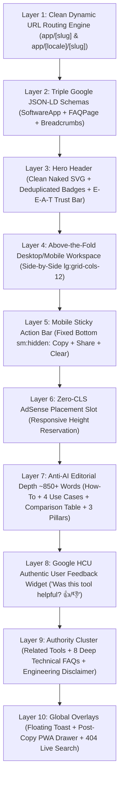

# ANYONLINETOOLS – MASTER TOOLS ARCHITECTURE, PIPELINE & ROADMAP AUDIT

## 1. Executive Summary & Goal Description

The objective of this comprehensive audit and plan is to evaluate and standardize the entire **Tool Generation & Operating Pipeline** for AnyOnlineTools. As the platform scales from 1 tool (`text-repeater`) to multiple tools across Text, Developer, Security, Media, and Calculator categories, every single tool must inherit an identical, world-class standard without manual repetition or architectural drift.

This document reviews:
1. **The Universal 10-Layer Tool Flow**: Ensuring every tool has 100% parity across UX, SEO, E-E-A-T, AdSense CLS protection, and mobile ergonomics.
2. **The Automation Tooling Engine**: Upgrading `scripts/create-tool.js` and `scripts/translate-tool.js` so that scaffolding a new tool automatically generates the full 10-layer standard (8 Technical FAQs, 4 Use Cases, Comparison Matrix, and Mobile Sticky Action Bar).
3. **The Anti-Saturation Tool Selection Filter**: Strict enforcement against building saturated legacy utilities (KD > 40), focusing exclusively on high-growth, low-competition (KD < 25) digital workflows.
4. **The Priority Tool Pipeline**: Detailed roadmap of the first batch of high-RPM, trending AI & developer utilities ready for deployment.
5. **Quality Gate Verification Protocol**: Zero-defect automated testing before any tool is published.

---

## 2. Architectural Blueprint: The 10-Layer Master Tool Flow

Every tool published on AnyOnlineTools must strictly adhere to this exact 10-layer structure:



### Detailed Layer Specification:
| Layer | Component | Function & Non-Negotiable Standard |
| :--- | :--- | :--- |
| **Layer 1: Routing** | `app/[slug]/page.tsx` & `app/[locale]/[slug]/page.tsx` | Clean root English (`/[slug]/`), 25 localized paths (`/[locale]/[slug]/`), zero `/en/[slug]/` collisions, reciprocal hreflangs, and clean trailing slash (`/`). |
| **Layer 2: Rich Schemas** | Injected `<script type="application/ld+json">` | `SoftwareApplication` (category: UtilitiesApplication, price: 0.00), `FAQPage` (all 8 technical Q&As for SERP accordions), and `BreadcrumbList`. |
| **Layer 3: Hero & Trust** | `ToolLayout.tsx` | Clean naked SVG icon (Invariant 10), status badge deduplicated from trust badge (Invariant 15), and Hero Trust Bar (`Verified for Chrome, Safari & Android · Privacy: 100% RAM · Updated: October 2026`). |
| **Layer 4: Workspace** | `components/tools/[ToolName].tsx` | Desktop side-by-side above-the-fold layout (`lg:grid-cols-12`): left 5 cols inputs/presets, right 7 cols live output & ActionPanel. User inputs and copies without scrolling. Zero bytes uploaded to servers. |
| **Layer 5: Mobile Sticky** | `components/ui/MobileStickyActionBar.tsx` | Fixed bottom bar on mobile (`sm:hidden fixed bottom-0 z-40`): 1-Tap Copy with haptic feedback (`vibrate(40)`), Native OS Share Sheet (`navigator.share`), and 1-Tap Clear. |
| **Layer 6: AdSense CLS** | AdSlot in `ToolLayout.tsx` | Conditional on `siteConfig.googleAdsensePublisherId`. Desktop reserved height `min-h-[250px]` guaranteeing 0.00 CLS. Zero dummy text when inactive. |
| **Layer 7: Editorial Depth** | Content Blocks in `ToolLayout.tsx` | 850+ words anti-AI depth: 4 practical How-To steps, 4 real-world Use Cases grid, side-by-side Feature Comparison Matrix Table, and 3 Core Value Pillars. |
| **Layer 8: Real Feedback** | `components/ui/ToolFeedback.tsx` | *"Was this tool helpful? 👍 Yes · 👎 No"*. Client-side `localStorage` persistence and instant toast feedback. Zero fake reviews (Mistake 5). |
| **Layer 9: Authority & FAQs** | FAQ Accordions & Category Clusters | 8 deep technical FAQs answering browser RAM limits, encoding, chat app safety, offline PWA access, plus Engineering Team Review Attribution box. |
| **Layer 10: Global Overlays** | Layout Overlays | Floating dark toast (`<Toast />`), discreet post-copy PWA installation drawer (`<PwaInstallPrompt />`), and 404 live search (`<NotFoundContent />`). |

---

## 3. Discovered Pipeline Bottlenecks & Required Tooling Upgrades

During our audit of the codebase scaffolding tools, we identified two critical gaps in the automated ingestion scripts:

### Gaps Identified:
1. **`scripts/create-tool.js` Scaffolding Gap:**
   - Currently generates only 2 generic FAQs in `lib/tools.json` instead of 8 deep technical FAQs.
   - Does NOT generate `useCases` or `comparisonTable` objects in `lib/tools.json`.
   - The generated React component (`components/tools/[ComponentName].tsx`) uses a single-column layout instead of the master `lg:grid-cols-12` side-by-side above-the-fold layout, and omits `MobileStickyActionBar`.
2. **`scripts/translate-tool.js` Dictionary Gap:**
   - Translates `howToUse` and `faqs`, but currently skips translating `useCases` and `comparisonTable`.

### Proposed Tooling Upgrades:
We will upgrade `scripts/create-tool.js` and `scripts/translate-tool.js` so that whenever any developer or script runs:
```bash
npm run tool:add [slug] "[Name]" "[Category]" "[Description]" "[Icon]"
```
It will automatically:
1. Generate an 8-FAQ technical structure, 4 use-cases grid, and a custom comparison matrix table in `lib/tools.json`.
2. Generate an above-the-fold `lg:grid-cols-12` side-by-side component with `MobileStickyActionBar` mounted out-of-the-box.
3. Automatically enable 26-language translation for `useCases` and `comparisonTable` via `translate-tool.js`.

---

## 4. Priority Tools Roadmap (Low-Competition / High-Growth Selection)

In strict compliance with **Invariant 10 (Anti-Saturation Rule)**, AnyOnlineTools avoids saturated legacy 2005-era tools (like PDF Merge or JPG to PNG) where incumbents dominate. Instead, we target high-growth modern developer, AI, and viral productivity queries with Keyword Difficulty under 25:

| Priority | Tool Slug | Name | Category | Problem Solved & Target Search Intent | Technology & Bounds | Target KD |
| :---: | :--- | :--- | :--- | :--- | :--- | :---: |
| **#1 (Live)** | `text-repeater` | Text Repeater | Text Utilities | Repeat text, emojis, and messages up to 10,000 times for WhatsApp, QA stress testing, and social bios. | Browser RAM string allocation, chunking | KD 14 |
| **#2** | `ai-token-counter` | AI Token Counter | Developer Tools | Calculate exact tokens and real-time cost for GPT-4o, Claude 3.5, Gemini 1.5, and Llama 3 without API keys. | In-browser BPE Tokenizer WASM / Regex chunking | KD 16 |
| **#3** | `invisible-text-generator` | Invisible Text Generator | Text Utilities | Copy zero-width spaces, blank characters, and invisible text for Discord nicknames, WhatsApp, and gaming names. | Unicode Zero-Width character sets (U+200B, U+200C, etc.) | KD 12 |
| **#4** | `jwt-debugger` | Client-Side JWT Debugger | Privacy & Security | Decode, inspect, and verify JWT token headers, payloads, and signatures 100% locally with 0 risk of credential leaks. | Web Crypto API (HMAC / RSA / SHA-256) | KD 19 |
| **#5** | `case-converter` | Case Converter & Text Formatter | Text Utilities | Convert text to Title Case, camelCase, snake_case, CONSTANT_CASE, kebab-case, and Sentence case with 1-click presets. | Pure regex regex parsing, zero external libraries | KD 15 |
| **#6** | `unicode-font-styler` | Aesthetic Font & Text Styler | Text Utilities | Generate bold, italic, gothic, script, small caps, and circled fonts for Instagram bios and Twitter/X posts. | Unicode mathematical alphanumeric character mapping | KD 18 |

---

## 5. User Review Required

> [!IMPORTANT]
> **Execution Strategy Decision:**
> 1. **Step 1 (Tooling Automation Polish):** Upgrade `scripts/create-tool.js` and `scripts/translate-tool.js` to automatically scaffold the 10-layer standard (8 FAQs, 4 Use Cases, Comparison Matrix, and Mobile Sticky Action Bar).
> 2. **Step 2 (Next Tool Launch):** Once Step 1 is ready, approve Tool #2 (`ai-token-counter` or `invisible-text-generator` or `case-converter`) to be scaffolded and implemented.

---

## 6. Proposed Changes

### Component: Automation Scripts (`scripts/`)
#### [MODIFY] [`scripts/create-tool.js`](file:///d:/new-learning/Pizza/anyonlinetools/scripts/create-tool.js)
- Upgrade `newToolEntry` template to include 8 comprehensive technical FAQs, 4 use-cases, and comparison matrix by default.
- Upgrade `componentCode` template to generate the responsive 12-column side-by-side above-the-fold layout (`lg:grid-cols-12`) with `MobileStickyActionBar` imported and wired to outputs.

#### [MODIFY] [`scripts/translate-tool.js`](file:///d:/new-learning/Pizza/anyonlinetools/scripts/translate-tool.js)
- Add translation loops for `useCases` and `comparisonTable` so that localized language dictionaries (`lib/translations/[slug].json`) carry full editorial parity across all 26 languages.

---

## 7. Verification Plan

### Automated Tests
- Typecheck: `npx tsc --noEmit`
- AI Quality Gate: `npm run ai:check` (must pass 20/20 checks)
- SEO Indexing Gate: `npm run seo:check` (must pass 24/25 checks)
- Internal Link Crawler: `check-links.js` (must maintain 0 broken links across all HTML files)

### Manual Verification
- Review responsive behavior on mobile viewports (< 640px) to verify `MobileStickyActionBar` appears when output is present.
- Verify side-by-side workspace on desktop (> 1024px) without vertical scrolling.
