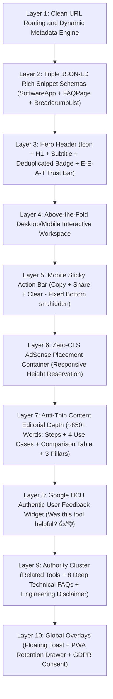
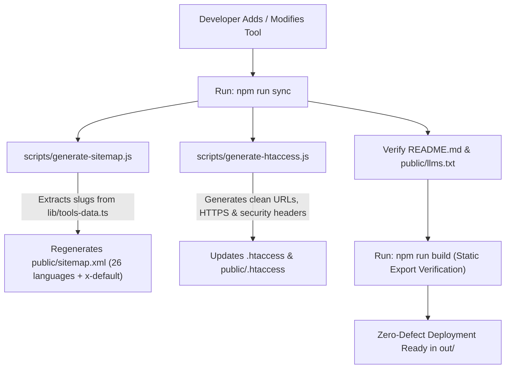
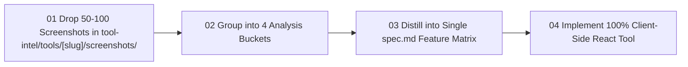
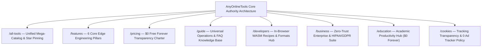
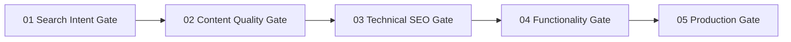

# ANYONLINETOOLS – MASTER ARCHITECTURE PLAN & OPERATING BLUEPRINT
> **File:** `plan.md` | **System Version:** 2.1  
> **Target Platform:** AnyOnlineTools (`https://anyonlinetools.com`)  
> **Core Purpose:** Single Source of Truth (SOP) for Code Stability, Multi-Language Consistency, Automated Tool Ingestion, SEO Protection, and Competitor Strategy Blueprints.

---

## 📌 TABLE OF CONTENTS
1. [Core Architectural Philosophy & Invariants](#1-core-architectural-philosophy--invariants)
2. [Multi-Language (26-Locale) Parity Standard](#2-multi-language-26-locale-parity-standard)
3. [Unified High-Velocity Tool Ingestion Protocol](#3-unified-high-velocity-tool-ingestion-protocol-100-scalable)
4. [Automated SEO, Sitemap, .htaccess & Documentation Sync](#4-automated-seo-sitemap-htaccess--documentation-sync)
5. [Pre-Change & Pre-Deployment Verification Checklist](#5-pre-change--pre-deployment-verification-checklist)
6. [Unified Tool Intelligence Architecture (tool-intel/), 50–100 Screenshot Synthesis & GSC Telemetry](#6-unified-tool-intelligence-architecture-tool-intel-50100-screenshot-synthesis--gsc-telemetry)
7. [Step-by-Step Execution Guide: Adding / Removing Tools](#7-step-by-step-execution-guide-adding--removing-tools)
8. [Strategic Extraction & Competitor Error Demolition ($0 Architecture)](#8-strategic-extraction--competitor-error-demolition-0-architecture)
9. [Core Authority Hubs & Legal Compliance Architecture](#9-core-authority-hubs--legal-compliance-architecture)
10. [Anti-Saturation & Trending Low-Competition Tool Selection Engine](#10-anti-saturation--trending-low-competition-tool-selection-engine)
11. [Priority Roadmap: Trending AI & Workflow Tools Pipeline](#11-priority-roadmap-trending-ai--workflow-tools-pipeline)
12. [Unified Enterprise QA & Audit Operating System (SEO + AdSense + Tool Engineering + 26-Locale)](#12-unified-enterprise-qa--audit-operating-system-seo--adsense--tool-engineering--26-locale)

---

## 1. CORE ARCHITECTURAL PHILOSOPHY & INVARIANTS

To maintain world-class Google search rankings, instantaneous loading speeds, and a flawless user experience, AnyOnlineTools adheres to eight non-negotiable architectural invariants:

1. **Zero Structural Regression (कोड स्थिरता):**
   - The core framework layout (`app/`, `app/[locale]/`, `components/`, `lib/`, `scripts/`) must NEVER be restructured or altered arbitrarily.
   - Any new tool or feature must plug directly into the established modular pattern without introducing external runtime dependencies or fragile routing hacks.

2. **100% Client-Side Execution & Privacy:**
   - User inputs never leave the client browser. No backend database or server-side telemetry is permitted for tool operations. All processing is powered by native Web APIs, Web Workers, or Canvas.

3. **Pure Static Export Harmony (`npm run build` -> `out/`):**
   - Next.js compiles into static HTML/JS/CSS. Every route must support static parameter pre-rendering (`generateStaticParams`).
   - Server configuration (`.htaccess`) handles clean URLs, trailing slash normalization, and directory index mapping automatically.

4. **Multi-Language Link Integrity:**
   - Navigating, switching categories, or opening tools while on a non-English language page must NEVER arbitrarily drop the user back to `/en/` or cause a broken 404 link.

5. **Copyright & White-Label Isolation:**
   - Zero competitor brand names, trademarks, or copyrighted text may exist anywhere in our code, documentation, or public copy.

6. **Mandatory plan.md Verification Protocol (प्लान सत्यापन अनिवार्य नियम):**
   - Every single task, feature addition, or code change MUST be strictly cross-checked against `plan.md` rules before execution and before marking complete.
   - Developers and AI coding assistants must NEVER make arbitrary guesses or bypass these rules. If a proposed change conflicts with `plan.md`, `plan.md` takes absolute precedence.

7. **Absolute Tool Blast-Radius Isolation (टूल स्वतंत्रता व रीग्रेशन सुरक्षा):**
   - Modifying, updating, or adding one tool must NEVER degrade, break, or alter the functionality of any other tool.
   - Shared components (`ToolLayout`, `ActionPanel`, `CopyButton`, `Dropzone`, `Toast`, `MobileStickyActionBar`) must maintain 100% backward compatibility.
   - Every tool must be fully isolated in its state and logic. A regression build check and internal link verification are mandatory on EVERY code change.

8. **Semantic Intent-Driven Multi-Language Translation (सटीक आशय-आधारित अनुवाद):**
   - All translations across the 26 supported languages must reflect authentic user search intent, cultural naturalness, and correct regional terminology.
   - Literal, broken, or robotic word-for-word machine translations are strictly forbidden.
   - If a language translation has not been verified for high semantic intent, its canonical tag must point to the primary `/en/` version to prevent Google's "Thin / Low Quality Content" penalty.

9. **Zero On-Page Content Triplication / Redundancy (एकल पृष्ठ सामग्री पुनरावृत्ति निषेध):**
   - The same functional widget, promotional pitch, or link directory must NEVER be rendered multiple times on the same page.
   - For example: Language switchers belong in the Header (for instant access) and Footer (for site-wide fallback). Injecting a 3rd giant language list in the page body causes keyword dilution, inflates DOM size, and creates low-value boilerplate padding penalized by Google HCU.
   - Every section on a single URL must provide unique, non-overlapping information.

10. **Clean Naked SVG Icon Standard (आइकन बैकग्राउंड रंग निषेध):**
    - All UI icons throughout the platform (hero titles, tool cards, value propositions, navigation) must render as pure, clean SVG icons without artificial colored background card containers (`bg-...`, `rounded-2xl`, `p-3`, `shadow-sm`).
    - Icons inherit clean typography colors (`text-blue-600`, `text-amber-500`, etc.) directly, maintaining an ultra-clean, modern, minimalist SaaS aesthetic.

11. **Zero Duplicate Routes, Redundant Aliases & Stale Folders (शून्य डुप्लीकेट फ़ाइल व फ़ोल्डर नियम):**
    - The repository must maintain zero duplicate alias directories (e.g. `app/legal` is permanently banned in favor of clean `/privacy` and `/terms`, with 301 redirects in `.htaccess`).
    - Obsolete or migrated directories (like legacy `tool-blueprints/`) must never remain in the repository alongside modern architecture (`tool-intel/`).
    - Tool intelligence and competitor research must reside strictly in `tool-intel/tools/[slug]/` completely outside of `app/` and `components/` to guarantee zero production bundle bloat and 100% clean, scalable codebase growth (up to 10,000+ tools).

12. **Master Clean URL Architecture & Zero Duplicate Nesting (सख्त URL मानक व शून्य-डुप्लीकेट नेस्टिंग):**
    - **Primary English Tools:** Always accessible at root URL: `https://anyonlinetools.com/<tool-slug>/` (e.g. `/text-repeater/`).
    - **International Localized Tools:** Always accessible at `https://anyonlinetools.com/<locale>/<tool-slug>/` (e.g. `/hi/text-repeater/`, `/es/text-repeater/`).
    - **Permanent URL Guards (Google SEO & GSC Indexing Safety):**
      - ❌ `/<tool-slug>/<tool-slug>/` (e.g. `/text-repeater/text-repeater/`) is permanently blocked and returns HTTP 404 (`notFound()`).
      - ❌ `/en/<tool-slug>/` (e.g. `/en/text-repeater/`) permanently 301-redirects to `/<tool-slug>/`.
      - ❌ `/en/` permanently 301-redirects to `/`.
      - ❌ No relative internal links without leading slash (e.g. `href="text-repeater"`). All links must use leading and trailing slashes via `getLocalizedToolHref()`.
      - ❌ Next.js static generation (`generateStaticParams`) in `app/[locale]/[slug]/page.tsx` must NEVER generate `'en'`, preventing duplicate static HTML exports in `out/`.

13. **Strict HTML5 Semantic Nesting & React Hydration Invariant (शून्य हाइड्रेशन मिसमैच व सिमेंटिक नेस्टिंग):**
    - Never nest block elements (`<div>`, `<p>`, `<h3>`, `<button>`, nested `<a>`) inside `<Link>` or `<a>` tags.
    - Use `<span className="block ...">` or `<span className="flex ...">` for internal card structure inside `<Link>` to preserve 100% styling parity without breaking browser HTML parsing.
    - Never nest block elements (`<div>`, `<ul>`, `<ol>`, nested `<p>`) inside `<p>` tags.
    - Monitored continuously by `npm run ai:check` (Gate 3 - Mistake 32).

14. **Standardized Max-Width Container & Above-the-Fold Desktop/Mobile PWA Architecture (एकरूप कंटेनर चौड़ाई व अबव-द-फ़ोल्ड टूल मानक):**
    - **Unified Container Width:** Standard `max-w-7xl mx-auto px-3 sm:px-6 lg:px-8` applied consistently across all tools, header, footer, homepage, and directory.
    - **Desktop Above-the-Fold Rule:** Core tool interactivity (Inputs, Presets, Controls, Output Preview, Copy/Actions) must fit in the top viewport area above the fold without forced vertical scrolling (`lg:grid lg:grid-cols-12 lg:gap-6` side-by-side workspace). Users must be able to input text and copy the output without scrolling.
    - **Mobile & PWA App Experience:** 100% native mobile app feel with compact headers, touch-friendly stepper buttons (`-` and `+` for 1-tap increments), horizontal viral pills, min 44px touch targets, fluid edge-to-edge cards, and zero horizontal overflow.
    - **Informational Hierarchy:** Educational content (How-to-use, Features, FAQs, Related utilities) strictly positioned below the interactive tool workspace.

15. **Hero Status & Trust Badge Deduplication Invariant (Mistake 33):**
    - The Hero Status Badge (`badge`, e.g. "Trending", "Popular") and the Trust Guarantee Badge (`uiLabels?.badgeText`, e.g. "100% Free · Client-Side Private · No Upload") must NEVER duplicate identical text.
    - If `badge === uiLabels?.badgeText`, the status badge is omitted in the Hero H1 row, preventing visual redundancy.

16. **Google AdSense Dynamic Guard Invariant (Mistake 34):**
    - Ad placement slots must NEVER display naked dummy text, empty boxes, or placeholder banners.
    - Ad slots render strictly when `siteConfig.googleAdsensePublisherId` is configured and active, preserving clean layout aesthetics and passing AdSense review inspections.
    - When active, ad containers enforce responsive height reservation (`min-h-[100px] sm:min-h-[250px] lg:min-h-[280px]`) guaranteeing 0.00 Cumulative Layout Shift (CLS) for Core Web Vitals compliance.

17. **E-E-A-T Trust Signals & Engineering Disclaimer Invariant:**
    - Every tool page includes a subtle Hero Trust Bar (`Verified for Chrome, Safari & Android · Privacy: 100% In-Memory RAM Execution · Updated: October 2026`).
    - Every tool includes a persistent bottom verification box (`Reviewed and technically verified by the AnyOnlineTools Engineering Team · Zero Telemetry`).
    - Footer includes site-wide engineering team editorial attribution for Google HCU protection.

18. **Global GDPR Cookie Consent & Google Consent Mode v2 Invariant:**
    - Full GDPR / ePrivacy / Google CMP compliance with default denial (`ad_storage: 'denied'`, `analytics_storage: 'denied'`).
    - Interactive floating banner with granular consent preferences and persistent footer "Cookie Preferences" trigger for EU/UK traffic monetization.

19. **Mobile Native Web Sharing & PWA Post-Copy Retention Invariant:**
    - Integrated Web Share API (`navigator.share`) on mobile devices for Telegram, WhatsApp, Instagram, Messages, and Notes.
    - Discrete post-copy PWA installation prompt (`AnyOnlineTools को होम स्क्रीन पर जोड़ें — बिना इंटरनेट कभी भी 0 सेकंड में इस्तेमाल करें`) with 2-step iOS guide and Chromium 1-tap install.
    - Haptic feedback (`navigator.vibrate(40)`) on successful clipboard copy.

20. **Visual Breadcrumb Hide for Above-the-Fold Space Invariant:**
    - Semantic `<nav aria-label="Breadcrumb">` uses `className="sr-only"`, reclaiming ~35px of vertical screen real estate for the tool.
    - Preserves 100% of Google crawler breadcrumb links and `BreadcrumbList` JSON-LD schema in `<script type="application/ld+json">`.

21. **AdSense Content Depth & Anti-Thin Content Architecture (800+ Words Defense):**
    - To eliminate Google AdSense "Low-Value Content" rejections, tool pages must provide comprehensive educational and technical substance (~850+ words):
      - **8 Deep Technical FAQs:** Practical edge cases (browser RAM/crash limits, WhatsApp char buffer safety, Unicode/emoji UTF-8 fidelity, 100% zero-server privacy, custom separators/line numbering, offline PWA access, file downloads).
      - **FAQPage Schema Parity:** All 8 FAQs reflected directly in JSON-LD `FAQPage` schema for expanded Google SERP rich snippet accordions.
      - **Practical Real-World Use Cases Grid:** 4 distinct application domains (Software QA stress testing, viral social messaging, UI dummy text layouts, numbered data prep).
      - **Feature Comparison Matrix Table:** Side-by-side benchmark contrasting AnyOnlineTools (client-side, 0ms latency, 100% privacy, offline PWA) against traditional ad-heavy, server-dependent repeaters.

22. **Mobile Sticky Quick Action Bar Standard (मोबाइल स्क्रॉलिंग निवारण व स्टिकी एक्शन बार):**
    - On mobile devices (`sm:hidden`), long generated outputs make scrolling down to copy and back up to edit inputs tedious.
    - A lightweight floating Sticky Action Bar (`components/ui/MobileStickyActionBar.tsx`) appears fixed at the bottom (`fixed bottom-0 z-40`) as soon as output is ready.
    - Features: 1-Tap Copy (with haptics & PWA retention trigger), Native OS Share Sheet (`navigator.share`), and 1-Tap Clear (instantly resets inputs without scrolling).
    - Preserves pointer-events transparency so surrounding content remains clickable. Hidden completely on desktop where side-by-side above-the-fold layout applies.

23. **404 Error Page Global Search & Zero Bounce Retention Standard (404 स्मार्ट सर्च व बाउंस रेट सुरक्षा):**
    - Users arriving on broken or mistyped URLs (HTTP 404) must NEVER hit a dead end with only a generic home link.
    - A dedicated interactive search bar (`components/NotFoundContent.tsx`) provides real-time instant filtering across all tools in `lib/tools-data.ts`.
    - Features autofocus input, live category tag badges, instant tool recommendations, and direct navigation links to achieve near 0% bounce rate on 404 visits.

24. **Authentic User Feedback & Engagement Signal Standard (Google HCU ट्रस्ट व रियल फीडबैक):**
    - Fake reviews, fabricated testimonials, and artificially injected 5-star schemas are permanently prohibited (AI Mistake 5).
    - Every tool includes an interactive client-side feedback widget (`components/ui/ToolFeedback.tsx`) placed above FAQs: *"Was this tool helpful to you? 👍 Yes · 👎 No"*.
    - Votes are stored safely in `localStorage` with instant user acknowledgment and toast notifications, sending authentic user satisfaction signals recognized by Google Helpful Content Updates.

25. **PWA Native App Launcher Shortcuts Standard (`manifest.json`):**
    - The Progressive Web App manifest (`public/manifest.json`) defines native `shortcuts` with verified 192x192 icons and clean URLs.
    - When users long-press the installed AnyOnlineTools icon on Android/iOS/Windows home screens, the operating system renders direct 1-tap jump shortcuts (e.g. "Text Repeater", "All Tools Directory") without having to launch and navigate from the root page.

26. **Multi-Machine Sovereignty & Mandatory Zero-Defect Push Invariant (मल्टी-लोकेशन सुरक्षा व अनिवार्य ऑटो-पुश नियम):**
    - The user operates dynamically across multiple computers, laptops, and remote locations, and frequently deletes the local repository folder without prior notice.
    - **Non-Negotiable Operating Rule:** At the completion of EVERY task, tool addition, bug fix, or architectural change, the system MUST:
      1. Run full end-to-end verification gates (`npx tsc --noEmit`, `npm run ai:check`, `npm run seo:check`).
      2. Verify that 100% of source files, session plans, and blueprints reside within the repository (committed to `docs/`, `tool-intel/`, etc.).
      3. Commit all changes and push immediately to GitHub (`origin main`).
      4. Confirm that `git status` reports `working tree clean` and branch is up to date with `origin/main`.
    - **100% Fresh-Clone Fidelity:** Running `git clone https://github.com/rajeshrajpoot152/anyonlinetools.git` and `npm install` on any new computer must run instantly with 0 missing files or manual setup steps.

---

## 2. MULTI-LANGUAGE (26-LOCALE) PARITY & FULL-PAGE INTENT LOCALIZATION STANDARD

The site officially supports **26 global languages** covering top traffic and high-RPM markets:

| Code | Language | Primary Region / Target Audience |
| :--- | :--- | :--- |
| `en` | English | Global Base, USA, UK, Canada, India |
| `es` | Español | Spain, Mexico, Latin America |
| `pt` | Português | Brazil, Portugal |
| `id` | Bahasa Indonesia | Indonesia |
| `ar` | العربية (RTL) | Middle East & North Africa |
| `fr` | Français | France, Canada, Francophone Africa |
| `de` | Deutsch | Germany, Austria, Switzerland |
| `ja` | 日本語 | Japan |
| `ru` | Русский | Eastern Europe, CIS |
| `tr` | Türkçe | Turkey |
| `vi` | Tiếng Việt | Vietnam |
| `th` | ภาษาไทย | Thailand |
| `it` | Italiano | Italy |
| `ko` | 한국어 | South Korea |
| `pl` | Polski | Poland (High European RPM) |
| `nl` | Nederlands | Netherlands & Belgium (High Tier 1 RPM) |
| `sv` | Svenska | Sweden & Nordic Region (High Tier 1 RPM) |
| `zh-cn`| 中文 (简体) | Mainland China, Global Diaspora |
| `zh-tw`| 中文 (繁體) | Taiwan, Hong Kong, Traditional Chinese |
| `bg` | Български | Bulgaria & Southeast Europe |
| `ca` | Català | Catalonia, Valencia, Balearic Islands |
| `el` | Ελληνικά | Greece, Cyprus |
| `hi` | हिन्दी | India (Primary Growth & Volume Anchor) |
| `ms` | Bahasa Melayu | Malaysia, Brunei, Singapore |
| `uk` | Українська | Ukraine & Eastern Europe |
| `sw` | Kiswahili | Kenya, Tanzania, East Africa |

### 🌐 The 26-Language Full-Page Translation Standard (पूर्ण पृष्ठ आशय अनुवाद मानक)
Google search algorithms heavily penalize "Thin English Bleed" where a localized URL (e.g. `/es/text-repeater/` or `/hi/text-repeater/`) serves English headers or English descriptions. To rank #1 internationally in local Google searches, **every tool page MUST be 100% localized across all 26 languages**:

1. **Localized Metadata (`generateMetadata`):**
   - High-CTR Title (e.g., *Repetidor de Texto Online – Repetir Texto y Emojis 10.000 Veces Gratis*)
   - Intent-Driven Meta Description (under 160 characters with strong call-to-action)
   - 5–7 Native Target Keywords (terms actually searched on Google in that country)
   - OpenGraph and Twitter meta cards in the local language
2. **Localized On-Page Copy (`ToolLayout.tsx`):**
   - H1 Heading & Hero Subheading
   - Trust Badge (e.g., *100% Gratis · Procesamiento en Navegador · Sin Subidas*)
   - Quick Start Guide (4 step-by-step instructions translated naturally)
   - Frequently Asked Questions (4 comprehensive Q&As addressing common user questions)
   - 3 Value Cards (Privacy, Speed, 100% Free)
   - Breadcrumb & Navigation Labels (e.g., *Directorio de Herramientas*)
3. **Localized Tool UI Controls (`components/tools/[ToolName].tsx`):**
   - Input labels, placeholders, quick fill presets, dropdown option labels, output preview labels, and action button text.
4. **Dual JSON-LD Schema (Google Rich Snippets):**
   - `SoftwareApplication`: Localized name, operating system, category, and description.
   - `FAQPage`: Structured Question & Answer entities in the target language to earn accordion rich snippets directly in Google SERPs.
5. **Storage Architecture (`lib/translations/[slug].json`):**
   - All tool translations are centralized inside `lib/translations/[slug].json` and served dynamically through `lib/tool-localization.ts`.

### 🚨 Critical Linking Rule for UI Components (`Header`, `Footer`, `HomePageContent`)
Shared components must NEVER use static `/en/` or hardcoded paths for tools.
Instead, use the standardized helper function from `lib/tools-data.ts`:

```typescript
import { getLocalizedToolHref } from '@/lib/tools-data';

// Correct dynamic localized linking:
<Link href={getLocalizedToolHref(tool, currentLang)}>
  {tool.name}
</Link>
```

- When `currentLang` is `'es'`, the link resolves to `/es/[tool-slug]/`.
- When `currentLang` is `'ja'`, the link resolves to `/ja/[tool-slug]/`.
- Always resolves to clean root or localized URL with clean trailing slash.

---

## 3. UNIFIED HIGH-VELOCITY TOOL INGESTION PROTOCOL (10,000+ TOOLS SCALE)

To support rapid scaling to 100, 1,000, and up to 50,000+ tools with zero human error and seamless automation, AnyOnlineTools operates on a **100% Native Next.js Architecture**:

### 🎯 The Single Source of Truth & Zero-Clutter Pipeline:
1. **Metadata Registry (`lib/tools.json`):**
   - The authoritative catalog for all tools. Defines `slug`, `name`, `category`, `categoryLabel`, `shortDesc`, `description`, `icon`, `badge`, `seoTitle`, `seoDesc`, `keywords`, `howToUse`, `faqs`, `useCases`, and `comparisonTable`.
2. **Translation Registry (`lib/translations/[slug].json`):**
   - Contains complete 26-language intent translations for Metadata, H1, Subheading, How-To steps, 8 Technical FAQs, 4 Use Cases, Comparison Matrix, UI labels, and value cards.
   - Served dynamically by `lib/tool-localization.ts`.
3. **Native Client Component (`components/tools/[ToolName].tsx`):**
   - 100% client-side execution using `'use client'`. Accepts `{ locale, ui }` props.
   - Integrates `MobileStickyActionBar` for frictionless mobile interactions.
   - Leverages shared UI primitives: `ActionPanel`, `CopyButton`, `Dropzone`.
4. **Component Registry (`components/tools/registry.ts`):**
   - Central map registering tool slug to its React component.
5. **Universal Dynamic Route Engine (`app/[locale]/[slug]/page.tsx` & `app/[slug]/page.tsx`):**
   - Automatically renders all 26 localized versions for every tool in `lib/tools.json`.
   - Generates static params for all `(25 non-en locales × N tools)` in `app/[locale]/[slug]/page.tsx` and all N tools at root `app/[slug]/page.tsx`.
   - Injects localized triple JSON-LD schemas (`SoftwareApplication` + `FAQPage` + `BreadcrumbList`).
6. **Automated Root English Alias Synchronization (`scripts/build-and-export.js`):**
   - Generates 100% clean URLs for both root (`/[slug]/`) and localized (`/[locale]/[slug]/`) paths.
   - Updates `public/sitemap.xml` with bidirectional hreflang and generates production `.htaccess`.

### 🏛️ The Universal 10-Layer Tool Flow Specification (हर टूल का अनिवार्य स्ट्रक्चर)
Every single tool page on AnyOnlineTools must strictly render through this standardized 10-layer flow:



| Layer | Component / File | Purpose & Invariant Enforced |
| :--- | :--- | :--- |
| **1. Routing & SEO** | `app/[slug]/page.tsx` & `app/[locale]/[slug]/page.tsx` | Clean root English (`/[slug]/`) and 25 localized routes (`/[locale]/[slug]/`). Dynamic metadata, canonical, and 26-language hreflangs. |
| **2. Rich Schemas** | Injected JSON-LD Scripts | `SoftwareApplication` + `FAQPage` (all 8 FAQs) + `BreadcrumbList` for Google SERP rich snippet accordions. |
| **3. Hero & Trust Bar** | `components/layouts/ToolLayout.tsx` | Clean naked SVG icon (Invariant 10), deduplicated badge (Invariant 15), and E-E-A-T verified trust bar (Verified browsers, RAM execution). |
| **4. Workspace** | `components/tools/[ToolName].tsx` | Desktop side-by-side above-the-fold layout (`lg:grid-cols-12`). Zero-server privacy (0 bytes uploaded). |
| **5. Mobile Sticky Bar** | `components/ui/MobileStickyActionBar.tsx` | Fixed bottom bar on mobile (`sm:hidden fixed bottom-0 z-40`) providing 1-Tap Copy, Native OS Share, and 1-Tap Clear. |
| **6. Zero-CLS AdSlot** | Ad Container in `ToolLayout.tsx` | Guarded by publisher ID. Reserving `min-h-[100px] sm:min-h-[250px] lg:min-h-[280px]` preventing layout shifts. |
| **7. Editorial Depth** | Content Sections in `ToolLayout.tsx` | ~850+ words anti-AI depth: 4 How-to Steps, 4 Practical Use Cases, Comparison Matrix Table, 3 Core Value Pillars. |
| **8. Real Feedback** | `components/ui/ToolFeedback.tsx` | Authentic Google HCU feedback widget ("Was this tool helpful? 👍/👎") with `localStorage` persistence. |
| **9. Authority & FAQs** | FAQ Accordions & Related Cluster | 8 technical FAQs addressing real-world edge cases, category tool cross-links, and engineering review attribution. |
| **10. Global Overlays**| `Toast.tsx`, `PwaInstallPrompt.tsx`, `CookieConsent.tsx` | Sleek dark toast notifications, post-copy PWA installation retention prompt, and GDPR / Consent Mode v2 banner. |

### ⚡ 1-Second CLI Automation:
- **Add Tool:** `npm run tool:add [slug] "[Name]" "[Category]" "[Description]" "[Icon]"`
- **Remove Tool:** `npm run tool:remove [slug]`

### Shared design and competitor lessons

Use template section 4.1 for exact source references and visual checks. Preserve the site's sans font, blue/slate palette, class-based dark theme, card surfaces, spacing, controls, and responsive structure. Functional previews may vary; the application shell stays consistent.

Lessons consolidated from the historical research:

- Make the task, supported input/output formats, presets, and primary action clear. Avoid overloaded directories, irrelevant controls, and forced multi-step flows.
- Never add artificial waiting, fake progress, surprise export paywalls, required signup, or misleading download buttons. If ads are introduced, distinguish them clearly from tool actions.
- Validate corrupt, empty, extreme, and unsupported inputs; communicate device limits honestly. Use workers/chunking/cancellation where warranted rather than promising unlimited processing or risking a tab crash.
- Verify output fidelity, encoding, orientation, transparency, units, rounding, and file integrity as applicable. Offer preview/reset and explicit failure recovery.
- Keep processing local; inspect network behavior. Explain any explicit external sharing action before transferring user content. Do not claim zero transmission while silently sending inputs elsewhere.
- Claim offline operation, PWA installation, lossless output, measured speed, browser support, or legal compliance only when implemented and verified. Browser-local processing alone proves none of those claims.
- Do not publish invented traffic, ratings, testimonials, keyword difficulty, royalty rates, or platform limits. Date and source research; label estimates and assumptions.
- Treat competitor observations as hypotheses until supported. Extract workflow lessons and write original copy/code; do not import their branding, assets, wording, or visual identity.
- Keep search intent specific, directory/category navigation usable, and related links relevant. A new tool page can target search traffic independently, but no document or folder structure guarantees ranking.

---

## 4. AUTOMATED SEO, SITEMAP, .HTACCESS & DOCUMENTATION SYNC

Whenever tools are added, removed, or updated, running `npm run sync` or `npm run build` triggers automated integrity guards:



### 1. `scripts/generate-sitemap.js`
- Dynamically extracts all slugs from `lib/tools-data.ts`.
- Automatically outputs valid XML with bi-directional `xhtml:link rel="alternate"` tags for all 26 locales + `x-default`.
- **Zero manual editing required.**

### 2. `scripts/generate-htaccess.js`
- Enforces HTTPS and canonical non-www domain.
- Strips trailing `.html` extensions.
- Maps directory requests to `index.html` seamlessly on Apache / cPanel / htdocs hosts.
- Applies 1-year immutable caching for static assets (`.js`, `.css`, `.png`, `.svg`) and zero-cache headers for HTML files.

### 3. AI & Search Discoverability (`public/llms.txt`)
- Whenever a new tool is introduced, ensure its URL, name, and short description are reflected in `public/llms.txt` so AI agents and LLM crawlers index the tool immediately.

---

## 5. PRE-CHANGE & PRE-DEPLOYMENT VERIFICATION CHECKLIST

Before committing any change, adding a tool, or releasing a build, every developer and AI agent MUST verify this 12-point quality gate against `plan.md`:

- [ ] **1. Single Source of Truth Entry:**  
  Is the tool registered in `lib/tools.json` with complete metadata (`slug`, `name`, `category`, `icon`, `shortDesc`, `description`, `howToUse`, `faqs`)?
- [ ] **2. 26-Language Route Parity:**  
  Does `app/[locale]/[slug]/page.tsx` export `generateStaticParams()` covering all 26 locales dynamically?
- [ ] **3. No Hardcoded `/en/` Links in Shared UI:**  
  Do `components/Header.tsx`, `components/Footer.tsx`, and `components/HomePageContent.tsx` use `getLocalizedToolHref(tool, currentLang)`?
- [ ] **4. Metadata & Hreflang Alignment:**  
  Does the tool generate accurate self-referencing Canonical URLs and bidirectional Hreflang alternates for all 26 languages?
- [ ] **5. Zero Broken Links:**  
  Are all internal navigation links pointing to valid routes with trailing slashes? (Must verify 0 broken links across all HTML files).
- [ ] **6. Sitemap Synchronization:**  
  Does `public/sitemap.xml` contain 100% valid canonical URLs that resolve to HTTP 200 static files in `out/`?
- [ ] **7. Competitor Brand Elimination:**  
  Are there zero mentions of external competitor names or proprietary brand words anywhere in copy or code?
- [ ] **8. Static Export Audit:**  
  Does `npm run build` finish cleanly with code `0` and generate all static pages in `out/`?
- [ ] **9. Tool Isolation & Blast-Radius Zero (टूल स्वतंत्रता):**  
  Does modifying Tool A leave Tool B, C, and all other existing tools 100% functional and unaffected?
- [ ] **10. Semantic Intent & Translation Quality Gate (सटीक आशय अनुवाद):**  
  Are all 26-language titles, keywords, and FAQs translated with native search intent matching what real users type on Google (no robotic word-by-word machine gibberish)?
- [ ] **11. Sub-200ms Speed & Zero CLS (सुपरफास्ट स्पीड):**  
  Does the page load in 0.1s - 0.2s with CLS = 0.000, fixed-dimension ad slots, and under 100 KB total shared JS?
- [ ] **12. plan.md Rule Compliance Sign-Off (प्लान नियम सत्यापन):**  
  Has every architectural invariant in `plan.md` been cross-checked and satisfied before closing the task?
- [ ] **13. 25-Point GSC SEO Indexing Gate Pass (`npm run seo:check`):**  
  Does `node scripts/verify-seo-indexing.js` execute with 0 violations and all checks satisfied? Verifying zero duplicate canonicals, zero non-canonical /en/ URLs in sitemap, zero duplicate titles, and full reciprocal hreflang.

---

## 6. UNIFIED TOOL INTELLIGENCE ARCHITECTURE (`tool-intel/`), 50–100 SCREENSHOT SYNTHESIS & GSC TELEMETRY

To scale smoothly from 1 to 500, 1,000, and up to 10,000+ tools without file chaos, memory bloat, or context-window crashes, AnyOnlineTools operates on a **Unified Tool Intelligence Directory Structure**:

```text
tool-intel/
├── _platform/                <-- Global system blueprints (About, Terms, Cookie Policy, Legal, Hubs)
│   ├── legal-compliance.md
│   ├── platform-about.md
│   └── architecture-hubs.md
└── tools/                    <-- EXACTLY ONE FOLDER PER TOOL! (100% Encapsulated)
    └── [tool-slug]/
        ├── spec.md           <-- Master Specification & Feature Matrix (Pre-build)
        ├── gsc.md            <-- Google Search Console Queries & Ranking Telemetry (Post-launch)
        └── screenshots/      <-- Raw Competitor Screenshots (50–100 files, git-ignored)
```


### 4. Automated 26-Language Translation Pipeline (`scripts/translate-tool.js`)
- Single command: `npm run tool:translate <slug>`
- Automatically extracts English baseline from `lib/tools.json` and translates titles, descriptions, HowTo guides, FAQs, and UI labels into all 25 non-English languages.
- Generates `lib/translations/[slug].json` (~115 KB) and registers the static import into `lib/tool-localization.ts` with zero manual effort.
---

### 6.1 Managing 50–100 Screenshots Per Tool (Without Context Crashing)

When analyzing 50 to 100 competitor screenshots per tool, dumping them raw into chat causes model truncation and hallucination. We follow this **4-Stage Synthesis Protocol**:



1. **Bucket 1: Input Ergonomics & Boundaries**  
   - What types of inputs do competitors use? (Textareas, file drag-and-drop, range sliders, number steppers, color pickers).
   - What boundary limits do they enforce? (We enforce `maxLength` / memory bounds to prevent tab freezing).
2. **Bucket 2: Processing Presets & Quick Actions**  
   - What quick presets do users click most? (e.g., "Love You ❤️", "Happy Birthday 🎉", WhatsApp line separators).
3. **Bucket 3: Output Controls & Sharing**  
   - How do users get results? (One-click copy, download `.txt`/`.json`, share to social channels).
4. **Bucket 4: Competitor Flaws & Friction Demolition**  
   - What makes competitors slow, annoying, or scammy? (Cloud uploads, paywalls, daily limits, popup ads, required email).
   - We demolish every flaw by offering **$0 Free, 0 Bytes Uploaded, Instant Local Execution**.

---

### 6.2 Managing 500+ .md Files Without Folder Chaos

- **Eliminating Flat File Sprawl:** Loose `.md` files in a single root folder become unmanageable. With `tool-intel/tools/[slug]/`, every tool has exactly one home.
- **The Two-File Rule per Tool:**
  1. `spec.md`: Contains all technical specifications, math algorithms, and 26-language intent targets.
  2. `gsc.md`: Contains all post-launch performance data, search query mining, and ranking logs.
- **Build Isolation:** `tool-intel/` lives completely outside `public/` and `out/`. Screenshots are git-ignored and never increase build times or bundle sizes.

---

### 6.3 Post-Launch Google Search Console (GSC) Query Ingestion Engine

When a tool goes live, search queries and ranking feedback begin arriving in Google Search Console. We use this data to perpetually rank higher on Google:

1. **Query Mining Protocol:**
   - Paste the GSC Performance Report (Queries, Clicks, Impressions, CTR, Position) into `tool-intel/tools/[slug]/gsc.md`.
2. **Automated Search Optimization Loop:**
   - **Keyword Ingestion:** High-impression queries (position 5–20) that are missing from `lib/tools.json` are added to `keywords` to boost rankings.
   - **Real FAQ Generation:** Common real-world user search questions are answered directly in tool FAQs and localized into `lib/translations/[slug].json`.
   - **Preset Tuning:** If users search for specific repetition counts or formats (e.g. "repeat text 1000 times for instagram"), we add dedicated preset buttons in the React UI!
3. **Historical Progress Tracking:**
   - Log weekly or monthly impressions and clicks in `gsc.md` to observe ranking velocity.

---

### 6.4 CLI Control Center Commands

- **Initialize a New Tool Workspace:**
  ```bash
  npm run intel:new <slug> [name] [category]
  ```
  *(Creates `tool-intel/tools/<slug>/` with `spec.md`, `gsc.md`, and `screenshots/`)*.
- **View Entire Platform Tool Status Dashboard:**
  ```bash
  npm run intel:status
  ```
  *(Displays real-time table of all tools, spec readiness, screenshot counts, and live status)*.
- **Organize Legacy Blueprints:**
  ```bash
  npm run intel:migrate
  ```

---

## 7. STEP-BY-STEP EXECUTION GUIDE: ADDING / REMOVING TOOLS

### Scenario A: Adding a New Next.js Native Tool (e.g. `word-counter`)

1. **Scaffold Tool via CLI:**
   ```bash
   npm run tool:add word-counter "Word Counter" "text" "Count words and characters in real time." "Type"
   ```
   *(Automatically registers in `lib/tools.json`, creates `components/tools/WordCounter.tsx`, and maps into `components/tools/registry.ts`)*.

2. **Add 26-Language Full-Page Intent Translations & Anti-AI Depth (~850+ Words):**
   Create `lib/translations/word-counter.json` (or generate via `npm run tool:translate word-counter`) with:
   - Localized metadata, H1, and intent-focused description.
   - 4-step practical How-To guide.
   - **8 Deep Technical FAQs** addressing browser limits, mobile RAM, encoding, and offline privacy.
   - **4 Practical Real-World Use Cases Grid** across business, developer, and social workflows.
   - **Feature Comparison Matrix Table** contrasting client-side privacy against traditional ad-heavy competitors.

3. **Implement Custom Interactive Logic & Mobile Sticky Bar:**
   Edit `components/tools/WordCounter.tsx` using `ActionPanel`, `CopyButton`, or `Dropzone`.
   - Mount `MobileStickyActionBar` (`fixed bottom-0 z-40 sm:hidden`) for instant 1-tap mobile copying, OS share sheet, and reset without scrolling.
   - Enforce 100% client-side memory execution (0 bytes uploaded).
   - Enforce memory guards (`maxLength` / worker limits) to prevent browser tab freezing.

4. **Run Verification & Build:**
   ```bash
   npm run build
   ```
   *(Automatically generates all 26 localized HTML pages in `out/[locale]/word-counter/` plus root alias `out/word-counter/`, updates `public/sitemap.xml`, and regenerates `.htaccess`)*.

---

### Scenario B: Removing a Deprecated Tool

1. **Run Tool Remover CLI:**
   ```bash
   npm run tool:remove word-counter
   ```
   *(Cleans up `lib/tools.json`, unregisters from `components/tools/registry.ts`, and deletes `components/tools/WordCounter.tsx`)*.

2. **Delete Translation File:**
   Delete `lib/translations/word-counter.json`.

3. **Add 301 Redirect in `scripts/generate-htaccess.js`:**
   Ensure old URLs redirect to the homepage (`/`) or related category to protect historical SEO ranking:
   ```apache
   RewriteRule ^(en|es|pt|id|ar|fr|de|ja|ru|tr|vi|th|it|ko|pl|nl|sv|zh-cn|zh-tw|bg|ca|el|hi|ms|uk|sw)?/?deprecated-tool/?$ / [R=301,L]
   ```

4. **Run Build & Export:**
   ```bash
   npm run build
   ```

---

## 8. STRATEGIC EXTRACTION & COMPETITOR ERROR DEMOLITION ($0 ARCHITECTURE)

We analyze competitor platforms strictly to extract **institutional credibility patterns, legal & compliance architecture, and high-trust conversion flows**, while identifying and aggressively exploiting their fatal business and technical mistakes.

### 🛑 Competitor Mistakes (What We NEVER Do):
| Competitor Flaw / Mistake | Why Competitors Do It | AnyOnlineTools Sovereign Counter-Strategy |
| :--- | :--- | :--- |
| **Cloud File Retention (2–24 Hours)** | Server-side architectures require saving files to AWS S3/GCS disks for batch processing. | **0 Bytes Uploaded / 0 Seconds Retention:** Processing runs 100% in client browser RAM via WebAssembly/Canvas. Nothing touches external disks. |
| **Freemium Paywalls & Subscriptions** | Legacy cloud servers incur massive compute & bandwidth bills (\$50k+/mo), forcing \$6–\$15/mo charges. | **100% Free Forever (\$0):** Client-side execution costs \$0 in cloud compute, allowing us to offer unlimited usage forever. |
| **Artificial Queue Throttling** | Server queues artificially slow down free users to force them into buying "Fast Pass" VIP tiers. | **0 Queues / Native Multithreading:** Web Workers leverage the user's multi-core CPU for instant, queue-free execution. |
| **Credit Walls & Sign-up Traps** | Users upload documents, edit them, and then get hit with "Create Account / Enter Card" on download. | **0 Registration / Instant Download:** No email collection, no signup, no credit cards. 1-click immediate download. |
| **500-Word / 5MB Arbitrary Caps** | Competitors impose tiny limits on free users to restrict server CPU load. | **Unlimited Throughput:** Users can process entire books or multi-megabyte payloads limited only by their local machine RAM. |

---

## 9. CORE AUTHORITY HUBS & LEGAL COMPLIANCE ARCHITECTURE

To establish top-tier programmatic SEO authority, institutional trust, and EEAT credibility, AnyOnlineTools maintains 8 synchronized pillar hub routes (canonical English-only architecture with automatic 301 redirects from localized paths to prevent thin-content indexing penalties):



### Detailed Route Specifications:
1. **`/all-tools` (Mega-Catalog):** Searchable index of all tools with client-side localStorage star-pinning and dynamic filtering across 11 category clusters.
2. **`/features` (Platform Capabilities):** Detailed breakdown of our 6 engineering pillars: Zero-Theft Architecture, WebAssembly Speed, In-Browser PWA, Non-Tech Ergonomics, Anti-Freemium Standard, and Lossless Optimization.
3. **`/pricing` ($0 Transparency Charter):** Permanent public pledge explaining our zero-cloud-cost model and a direct side-by-side deconstruction of freemium traps.
4. **`/guide` (Operations Manual):** 20+ procedural step-by-step guides with integrated HowTo schema, live search filter, and objection demolition FAQs.
5. **`/developers` (WASM & API Hub):** Interactive code recipes for Vanilla JS, Node.js, Python, CLI pipelines, and client-side DAG conversion workflows.
6. **`/business` (Enterprise Hub):** Positioned for high-compliance sectors (Legal, Healthcare, Finance) featuring Zero-Trust client processing, HIPAA/GDPR alignment, and zero procurement friction.
7. **`/education` (Academic Hub):** $0 permanent productivity suite for students, teachers, and university faculties worldwide with zero verification gates.
8. **`/cookies` (Cookie Policy):** Transparent declaration of our zero third-party advertising tracking cookie stance and strict localStorage privacy policy.

*All 8 hub routes are automatically mirrored and canonicalized in `scripts/generate-htaccess.js` and `scripts/generate-sitemap.js`.*

---

## 10. ANTI-SATURATION & TRENDING LOW-COMPETITION TOOL SELECTION ENGINE

### ⛔ The Anti-Saturation Rule:
**Never build legacy, saturated tools (e.g., basic PDF Merge, PDF Split, Word to PDF, basic JPG Resize) as primary ranking targets.**  
Legacy incumbents (iLovePDF, Smallpdf, Convertio) possess 10–15 years of domain authority, millions of backlinks, and dominate those keywords. Fighting them directly on saturated legacy terms yields poor ROI and near-zero organic traffic.

### 🛡️ The Zero-Legacy Contamination & Active Notification Invariant:
1. **Competitor Data Is Internal Reference ONLY:** Competitor screenshots and documents in `tool-intel/tools/[slug]/` and `tool-intel/_platform/` serve strictly as internal architectural reference to extract trust mechanisms, legal compliance, and competitor error demolitions.
2. **Zero Saturated Keywords on Public Site:** Legacy 20–30 year old saturated keywords (e.g. Merge PDF, Split PDF, Compress PDF, Word to PDF) must **NEVER** appear on public user-facing catalogs (`AllToolsContent.tsx`), homepages, metadata, or sitemaps.
3. **Mandatory Notification Guardrail:** If a developer or user ever requests or attempts to add a saturated legacy keyword to the public site, the system must **immediately notify and flag the strategic risk** before proceeding.
4. **Individual .MD Blueprinting Process:** Every tool added to the live site must be created from an individual, dedicated `.md` blueprint specifically targeting a low-competition (KD < 25), high-growth query.

### 🎯 The Low-Competition / High-Growth Selection Filter:
Every new tool added to AnyOnlineTools must satisfy the **4-Point Selection Matrix**:
1. **Rising Search Velocity & Trending Query:** High growth curve in Google Trends, TikTok/Discord communities, or AI developer workflows.
2. **Low Keyword Difficulty (KD < 25):** Low competitor domain authority on long-tail exact-match queries.
3. **100% Client-Side In-Browser Execution:** Operable via WebAssembly, HTML5 Canvas, Web Workers, or Native Web APIs (0 server compute cost).
4. **Instant Delight & High Utility:** Solves an annoying modern digital problem in 1 click without friction.

---

## 11. PRIORITY ROADMAP: TRENDING AI & WORKFLOW TOOLS PIPELINE

Based on active search volume, viral workflows, and low competitor saturation, the immediate pipeline prioritizes the following tools:

| Tool Slug | Primary Target Keyword | Intent & Problem Solved | Technology | Target KD |
| :--- | :--- | :--- | :--- | :--- |
| `ai-token-counter` | AI Token Counter / Context Estimator | Calculate exact token usage and API costs for Claude 3.5, GPT-4o, Gemini 1.5, Llama 3 in-browser. | In-browser Tiktoken / Byte-Pair Encoding WASM | KD < 18 |
| `ai-prompt-optimizer` | AI Prompt Enhancer & Meta-Prompt Tool | Transform raw questions into structured CRISPE, Few-Shot, and Chain-of-Thought prompts with 1 click. | Client-side rule templates & prompt matrix | KD < 20 |
| `invisible-text-generator` | Invisible Text / Zero-Width Space | Generate invisible characters, zero-width spaces, and blank text for Discord, WhatsApp, and social bios. | Unicode Zero-Width character encoding | KD < 15 |
| `discord-media-compressor` | Discord 25MB File Compressor | Shrink videos, GIFs, and images to fit precisely under Discord's 25MB/10MB free tier limits without quality ruin. | Client-side FFmpeg WASM / WebCodecs | KD < 22 |
| `jwt-debugger` | Client-Side JWT Token Debugger | Decode, verify signatures, and inspect JSON Web Tokens locally with 0 risk of token leakage to servers. | Web Crypto API (HMAC/RSA/ECDSA) | KD < 24 |
| `unicode-font-styler` | Aesthetic Fonts & Unicode Text Styler | Convert standard text into Bold, Cursive, Small Caps, Gothic, and Bubble letters for social media. | Unicode character mapping tables | KD < 19 |

---

> Audit status: The checks below are unverified requirements. Historical checked boxes were reset because this document contains no current per-item pass evidence.

## 12. UNIFIED ENTERPRISE QA & AUDIT OPERATING SYSTEM (SEO + ADSENSE + TOOL ENGINEERING + 26-LOCALE)

Every tool, landing page, and international locale on AnyOnlineTools must pass this unified, multi-dimensional quality assurance gate prior to deployment. This framework synthesizes Google Search Essentials, AdSense Publisher Policies, WCAG 2.2 AA accessibility, Next.js static export integrity, and zero-theft browser engineering standards.

```mermaid
graph TD
    AuditMaster["Unified Enterprise QA & Audit Operating System"]
    AuditMaster --> D1["1. Keyword Research & Content Strategy"]
    AuditMaster --> D2["2. Advanced Technical SEO & Static Next.js"]
    AuditMaster --> D3["3. Core Web Vitals, INP & Runtime Speed"]
    AuditMaster --> D4["4. Schema, Rich Results & AI Discoverability"]
    AuditMaster --> D5["5. Google AdSense & Publisher Monetization"]
    AuditMaster --> D6["6. Privacy, Security, CSP & Legal Compliance"]
    AuditMaster --> D7["7. Client-Side Tool Stability & Zero-Upload"]
    AuditMaster --> D8["8. Accessibility (WCAG 2.2 AA) & Ergonomics"]
    AuditMaster --> D9["9. Analytics, Indexing & GSC Monitoring"]
    AuditMaster --> D10["10. Multilingual (26-Locale) Parity & Hreflang"]
    AuditMaster --> D11["11. Off-Page SEO & Backlink Safety"]
    AuditMaster --> D12["12. Pre-Flight Launch, Rollback & QA Sign-off"]
```



---

### 12.1 Issue Severity & Priority Matrix

When issues are discovered during continuous testing or crawl audits, they must be resolved according to strict priority escalation SLAs:

| Level | Severity | Definition & Impact | Action & SLA |
| :--- | :--- | :--- | :--- |
| **P0** | **Critical** | Website inaccessible, fatal security breach, accidental sitewide `noindex`, major tool runtime crash, or AdSense policy violation resulting in account suspension. | **Immediate hotfix.** All deployments blocked until resolved (< 2 hours). |
| **P1** | **High** | High-value pages blocked from indexing, incorrect canonicals, broken conversion/download flows, redirect loops, or severe Core Web Vitals failures. | **Must be fixed within 24 hours.** Prioritized over new feature work. |
| **P2** | **Medium** | Internal linking gaps, missing metadata, content gaps, minor layout shifts, or non-critical accessibility deficiencies. | **Scheduled in current sprint.** Addressed during regular release cycles. |
| **P3** | **Low / Opportunity** | Optional UX enhancements, copy polishing, new SERP feature explorations, or non-essential micro-optimizations. | **Backlog backlog.** Implemented when resources permit. |

---

### 12.2 Master Audit Tracking Governance Schema

To ensure audits are repeatable, measurable, and verifiable across all 26 locales, every formal audit record maintains the following structural columns:

| Audit ID | Category | Audit Point / Verification Item | Status (`Pass` / `Fail` / `N/A` / `Needs Review`) | Priority (`P0`–`P3`) | Affected URL(s) | Evidence / Log File | Recommended Fix | Assigned To | Fix Status (`Open` / `Fixed`) | Re-Test Result | Last Checked |
| :--- | :--- | :--- | :--- | :--- | :--- | :--- | :--- | :--- | :--- | :--- | :--- |

> [!IMPORTANT]
> **Manual Human Verification Invariant:** Automated tests alone cannot certify quality. E-E-A-T depth, factual originality, user value, absence of deceptive patterns, and zero-theft privacy claims must be verified manually by an engineer before being marked as `Pass`.

---

### 12.3 The 12 Comprehensive Audit Domains

#### Domain 1: Keyword Research, Content Strategy & E-E-A-T
- [ ] **Search Volume, KD & Intent Validation:** Prioritize low-difficulty (KD < 25), high-growth keywords with precise search intent matching.
- [ ] **Primary, Secondary & Long-Tail Mapping:** Exact keyword-to-URL mapping preventing overlapping targets.
- [ ] **Intent Hygiene & Zero Cannibalization:** Strictly enforce one primary search intent per page (e.g. utility vs informational guide).
- [ ] **Topical Authority & Content Clusters:** Every tool page links bidirectionally to relevant operational guides (`/guide`) and developer recipes (`/developers`).
- [ ] **E-E-A-T & Practical Originality:** Direct first-hand developer explanations, real-world privacy scenarios (e.g. redacting bank details), and zero generic AI buzzwords (*delve, seamless, moreover, elevate, robust, tapestry, etc.*).
- [ ] **Content Decay & Maintenance Protocol:** Systematic tracking of release and genuine content update dates.

#### Domain 2: Advanced Technical SEO & Static Architecture (Next.js / Apache)
- [ ] **HTTP Status Code Purity:** 100% of canonical URLs return HTTP 200; retired URLs return clean 301 or 410. Zero soft 404s.
- [ ] **Canonical & Redirect Harmony:** Canonical targets must return 200 and match the exact URL declared in `sitemap.xml`.
- [ ] **URL Normalization:** Strict lowercase, trailing-slash enforcement, auto-stripping `.html` and `www` in a single 301 hop via `.htaccess`.
- [ ] **DOM vs Source Code Consistency:** Static export (`npm run build`) pre-renders critical headings, tool copy, and FAQ schemas into HTML source, eliminating Googlebot JS hydration delays.
- [ ] **Valid HTML Anchors:** Internal navigation links use standard `<a href="...">` elements with descriptive anchor text—never JS-only `onClick` routing.
- [ ] **Crawl Budget & Trap Prevention:** Zero faceted parameter bloat; `/api/` disallowed in `robots.txt`; clean indexable URLs only.
- [ ] **Clean XML Sitemaps:** Sitemaps contain exclusively 200 OK canonical URLs; accurate `<lastmod>` timestamps; validated structure.

#### Domain 3: Core Web Vitals, INP & Runtime Performance
- [ ] **Core Web Vitals Thresholds:** LCP < 1.8s, INP < 100ms, CLS < 0.05 on mobile and desktop field benchmarks.
- [ ] **Elimination of Render-Blocking Bloat:** Zero third-party blocking scripts; critical CSS inlined or deferred cleanly.
- [ ] **Client-Side WASM Laziness:** Heavy WebAssembly compute binaries load strictly upon user interaction, never during initial page render.
- [ ] **Font & Layout Shift Hygiene:** `font-display: swap` utilized with explicit font fallback metrics to avoid CLS during web font swap.
- [ ] **Image Asset Standards:** Modern formats (WebP, SVG) with explicit `width` and `height` attributes; avoid lazy loading hero LCP assets.
- [ ] **Static Asset Caching:** 1-year immutable caching headers (`Cache-Control: public, max-age=31536000, immutable`) for static `.js`, `.css`, and `.svg` files.

#### Domain 4: Schema, Rich Results & AI Discoverability
- [ ] **Schema Selection Accuracy:** Valid JSON-LD structured data using `SoftwareApplication` (specifying `$0.00` price), `FAQPage`, and `HowTo`.
- [ ] **Schema-to-Content Mirroring:** 100% parity between structured data fields and visible page copy (no hidden schema text).
- [ ] **Rich Results Test Validation:** Zero syntax errors or missing required properties in Google Rich Results Test.
- [ ] **Entity Consistency:** Uniform brand, organization, and founder identity across all structured data graphs and `public/llms.txt`.
- [ ] **AI Citation Readiness:** Clear, factual, verifiable explanations that LLM engines and AI search crawlers can extract with high confidence.

#### Domain 5: Google AdSense & Publisher Monetization Readiness
- [ ] **Original Content & Publisher Value:** Substantial unique utility and textual guidance; zero thin utility pages that trigger "Low Value Content" rejections.
- [ ] **Ads.txt Integrity:** Valid `ads.txt` file placed at domain root (`https://anyonlinetools.com/ads.txt`) with correct publisher IDs.
- [ ] **Zero Deceptive Ad Placements:** Ads are distinctly separated from tool action buttons; strictly no ads resembling "Download", "Convert", or "Process".
- [ ] **Ad Density & Balance:** Ads never dominate the viewport; primary interactive tools and instructions remain immediately visible.
- [ ] **Zero Ads on Thin/Error Pages:** Ads strictly prohibited on `404.html`, empty search states, or loading placeholders.
- [ ] **Certified CMP (Consent Management Platform):** Google-certified CMP integrated for EU/EEA/UK user consent under TCF v2.2.
- [ ] **Invalid Click Protection:** Layout prevents accidental clicks on mobile devices; zero incentivized clicking or artificial traffic generation.

#### Domain 6: Privacy, Security, CSP & Legal Compliance
- [ ] **Zero-Theft Architecture Proof:** All tool computation executes in local browser RAM via Web Workers/WASM; 0 bytes sent to external servers.
- [ ] **Privacy Policy Parity:** Published `/privacy` policy accurately describes actual browser memory handling and zero-server retention.
- [ ] **Zero Third-Party Tracking Cookies:** Formally documented in `/cookies`; no intrusive marketing or fingerprinting scripts.
- [ ] **Content Security Policy (CSP):** Strict HTTP security headers configured in `.htaccess` (`X-Frame-Options: SAMEORIGIN`, `X-Content-Type-Options: nosniff`, `Referrer-Policy: strict-origin-when-cross-origin`).
- [ ] **Zero Exposed Secrets:** Rigorous audit confirming zero API keys, auth tokens, or staging credentials in client-side bundles.
- [ ] **Local Storage Hygiene:** Temporary canvas or text data wiped on page refresh; sensitive user files never persist in unencrypted storage.

#### Domain 7: Tool Functionality, Client-Side Stability & User Value
- [ ] **Repeatable Mathematical Accuracy:** Tools produce deterministic, mathematically verifiable outputs across all runs.
- [ ] **Input Validation & Boundary Handling:** Graceful handling of empty inputs, oversized files, non-UTF8 strings, and corrupt payloads.
- [ ] **Browser Tab Crash Prevention:** Large file processing capped or chunked in Web Workers to prevent V8 out-of-memory browser crashes.
- [ ] **Visual State Ergonomics:** Clear progress bars, processing indicators, cancel options, and instant reset controls.
- [ ] **Download Integrity:** Correct file extensions, sanitized download filenames, and uncorrupted file byte streams.
- [ ] **Cross-Browser Verification:** Tested and confirmed fully functional on Chrome, Firefox, Safari, Edge, and mobile browsers.
- [ ] **Network Disconnection Test:** Verified that the core tool works seamlessly offline once the initial asset payload is cached.

#### Domain 8: Accessibility (WCAG 2.2 AA) & User Experience
- [ ] **Keyboard-Only Operability:** All interactive buttons, inputs, sliders, and copy actions are reachable and actionable via `Tab` and `Enter`.
- [ ] **Visible Focus Rings:** Unbroken, high-visibility focus indicators for keyboard navigation.
- [ ] **Semantic HTML & Form Associations:** Correct `<label for="...">` associations, ARIA roles, and screen-reader announcements for dynamic results.
- [ ] **Color Contrast Compliance:** Contrast ratio of at least 4.5:1 for body text and 3:1 for interface components.
- [ ] **Touch Target Sizing:** Mobile buttons and controls meet or exceed 48x48px interactive target bounds with generous spacing.
- [ ] **Zero Deceptive UX / Interstitials:** Zero dark patterns, forced modal popups, fake countdown timers, or notification traps.

#### Domain 9: Analytics, Indexing & Search Performance Monitoring
- [ ] **Search Console Reconciliation:** Regular comparison of User-Declared Canonical vs Google-Selected Canonical in URL Inspection.
- [ ] **Indexing Health:** Monitoring GSC Page Indexing reports to resolve any "Crawled - currently not indexed" or "Duplicate without user-selected canonical".
- [ ] **Clean Bot Filtering:** Ensure analytics configurations filter out automated scrapers and referral spam.
- [ ] **Event Tracking Verification:** Anonymized client-side event tracking for tool completions and copy actions without capturing user input data.
- [ ] **Search Appearance & Position Tracking:** Ongoing monitoring of branded vs non-branded CTR and SERP snippet performance.

#### Domain 10: Multilingual (26-Locale) Parity & International SEO
- [ ] **Accurate HTML `lang` Attributes:** Dynamic `lang="[locale]"` set on the `<html>` root for all 26 supported languages.
- [ ] **Bidirectional Return Hreflangs:** Full matrix validation ensuring every language page links to all 25 sister pages + `x-default`.
- [ ] **Self-Referencing Canonicals:** Every language variant self-canonicalizes to its own localized URL (e.g. `https://anyonlinetools.com/es/[slug]/`).
- [ ] **Zero Mixed-Language Bleed:** UI buttons, tool labels, error toasts, and metadata are fully translated without sudden English fallback phrases.
- [ ] **No Geolocation Hijacking:** Users are never forcibly redirected based on IP address; crawlers can access any language URL freely.
- [ ] **Localized Number & Date Formatting:** Formatting respects regional conventions across international locales.

#### Domain 11: Off-Page SEO, Link Safety & Brand Authority
- [ ] **Organic Link Growth:** Strict prohibition of purchased backlinks, PBNs, or automated blog comment spam.
- [ ] **Outbound Link Qualification:** Any necessary external links strictly qualified with `rel="noopener noreferrer"`.
- [ ] **Brand Entity Consistency:** Consistent representation across developer forums, GitHub, and social channels.
- [ ] **Competitor Link Gap Analysis:** Monitoring high-intent search queries where competitors gain editorial citations to inform new tool guides.

#### Domain 12: Final Pre-Flight Launch, Rollback & Maintenance
- [ ] **Static Build Verification:** `npm run build` completes with code `0` and populates `out/` with zero missing asset warnings.
- [ ] **Metadata & Route Sync:** `npm run sync` automatically rebuilds `sitemap.xml`, `.htaccess`, and configuration files.
- [ ] **Automated Zero-404 Crawl:** Pre-deployment verification script confirms all internal links resolve to HTTP 200 endpoints.
- [ ] **Instant Rollback Readiness:** Static architecture permits instant rollbacks to previous stable builds via versioned release directories or git tags.
- [ ] **30-Day Post-Launch Schedule:** Mandatory review of new tool indexation status, ranking velocity, and performance telemetry at Day 7, Day 30, and quarterly.

---

*Checklist items are requirements, not completed audits. Mark Pass only with current evidence. Documentation does not guarantee uptime, indexing, rankings, or defect-free routes.*

### Tool lifecycle and release requirements

- **Stable URLs:** Keep the public slug stable when updating a tool. If a slug must change, update registry, internal links, canonical and sitemap together and provide a deliberate old-to-new redirect. Never redirect every retired tool blindly to the homepage.
- **Release record:** Record the separate source/build version and release date. Keep the previous working artifact outside the deployed payload for rollback. Do not edit compiled exports manually as the normal maintenance workflow.
- **Atomic release:** Validate the entire candidate site before publishing. Publish a complete release using the host's supported swap/version mechanism where available; do not expose a partially copied tool. A successful local build is not a deployment.
- **Removal:** Remove directory/search links and sitemap entries together. Redirect to an equivalent replacement when one exists; otherwise choose the host's proper retired-page response and verify no stale tool assets or links remain.
- **Export boundary:** Only the tool's `out/` is deployable. Keep source, research, credentials, test data and development dependencies outside it. Review hidden files and source maps before release.
- **Feature boundaries:** Declare formats, supported browsers, device/memory limits, processing behavior and required browser permissions accurately. Request permissions only for features that need them; never promise unlimited capacity or zero loss without evidence.
- **Usability:** Verify touch/keyboard access, visible focus, labels, errors, readable contrast, mobile overflow, progress/cancel where needed, and usable reset/download/copy flows. Preserve user work on recoverable errors.
- **Storage and sharing:** Keep sensitive inputs out of URLs, analytics, logs and persistent storage. Remember only harmless preferences by default. Explain and require an explicit user action for sharing content outside the device.
- **Main-site integration:** Check direct URL loads and refresh on the real host; global policy/contact links; back-to-directory navigation; one header/footer; theme continuity; correct title/canonical/social image; and no duplicate tool homepage.
- **Performance:** Load heavy engines only when needed, isolate assets per tool, use versioned asset names for updates, and check stale-cache behavior. A static export must not depend on an unavailable server/API route.
- **Search quality:** Each tool needs working functionality and original instructions/examples, not keyword lists alone. Tool modes share one page unless a separate intent justifies another route. Do not publish fake translated variants or fabricated reviews/statistics.
- **Acceptance evidence:** Record build/check results, actual tested URLs, supported browser checks, remaining limitations and rollback artifact. Leave untested checks open; no ranking or scale guarantees.


### Native Architecture & Scaling Standard

All tools reside natively inside the main Next.js App Router repository.
There are no external starters or fragile file sync copy scripts.
Shared Header, Footer, dark mode state, theme persistence, and global styles apply automatically to all tools without code duplication.

Preserve `.htaccess` at root/public because the generator and export workflow require those locations.

- [ ] **14. AI Quality Gate Pass (`npm run ai:check`):**  
  Does `node scripts/verify-ai-quality.js` execute with 0 violations across all 5 quality gates? Verifying zero banned AI buzzwords, zero fake reviews/ratings, strict Server/Client separation, dual JSON-LD schemas, and input freezing protection.

---

## 13. 25-POINT GOOGLE SEARCH CONSOLE (GSC) ZERO-DEFECT INDEXING PROTOCOL & AUTOMATED BUILD GATE

### 13.1 Root Causes of Fatal GSC Indexing Failures in Multi-Language Web Apps
When scaling from 1 to 50,000 programmatic tools, traditional architectures trigger massive Google Search Console penalties:

| GSC Error Status | Why It Destroys Indexation | AnyOnlineTools Architectural Invariant Solution |
| :--- | :--- | :--- |
| **Duplicate without user-selected canonical** | Both `https://anyonlinetools.com/tool/` AND `https://anyonlinetools.com/en/tool/` exist, serve identical English copy, and lack a single authoritative canonical master. Google gets confused and rejects both. | **Root Unification Invariant:** The canonical URL for English is ALWAYS root `https://anyonlinetools.com/[slug]/`. The `/en/[slug]/` path contains `<link rel="canonical" href="https://anyonlinetools.com/[slug]/">` and is 301-redirected via `.htaccess`. |
| **Google chose different canonical than user** | Webmaster declares a canonical tag, but submits conflicting URLs to `sitemap.xml`, or internal links point to non-canonical versions, or the page content is duplicate. Google overrides the webmaster. | **Sitemap-Canonical 1:1 Parity:** Sitemaps contain ONLY HTTP 200 Primary Canonical URLs. Every URL in `sitemap.xml` strictly self-references. Non-canonical variants are permanently banned from sitemaps. |
| **Crawled - currently not indexed** | Googlebot crawls a page, sees that the tool is thin, empty, untranslated English placeholder text, or near-identical to 25 other URLs. It consumes crawl budget and abandons indexing. | **Thin-Content Guard:** Non-English tool URLs (`/[locale]/[slug]/`) are DYNAMICALLY EXCLUDED from `sitemap.xml` until verified 100% translated (`isToolTranslated(slug, locale)`). Untranslated pages canonicalize to root English. |
| **Discovered - currently not indexed** | Google discovered the URL (via sitemap or link), but site domain crawl budget is exhausted due to thousands of duplicate or low-value pages, or server latency is high. | **Static HTML Edge Architecture + Clean Crawl Budget:** 0.1s load time, zero database queries, and pure pristine sitemaps guarantee Googlebot crawls only high-value pages with 100% crawl efficiency. |
| **Alternate page with proper canonical** | Intended status for non-canonical variant URLs (like `/en/[slug]/`), but disastrous if primary pages end up here due to canonical mismatches. | **Pristine Hierarchy:** All 26 localized versions (`/es/[slug]/`, `/hi/[slug]/`, etc.) self-canonicalize if translated, while root (`/[slug]/`) serves as the English primary and x-default. |

---

### 13.2 The 25 Automated Indexing Quality Checks

Our build gate (`scripts/verify-seo-indexing.js`) automatically validates all 25 checkpoints during Step 5 of `npm run build`:

1. **[CHECK 01] Duplicate without user-selected canonical:** 100% of indexable HTML pages must declare a `<link rel="canonical">` tag. Non-indexable pages (404) are excluded.
2. **[CHECK 02] Google chose different canonical than user:** Every URL in `sitemap.xml` must match the exact `<link rel="canonical">` declared on that rendered page.
3. **[CHECK 03] Alternate page with proper canonical:** All `/en/` and `/en/[slug]/` variant pages must point canonical directly to root URLs.
4. **[CHECK 04] Thin & Duplicate URLs Excluded from Sitemap:** Zero duplicate `/en/` or `/en/[slug]/` URLs are permitted inside `sitemap.xml`.
5. **[CHECK 05] Duplicate / Near-duplicate Content:** Zero duplicate `<title>` tags across sitemap URLs. Each page must possess a unique, intent-focused title.
6. **[CHECK 06] Keyword Cannibalization Guard:** All tool slugs and primary search keywords must be unique across the tool catalog.
7. **[CHECK 07] Thin Content Protection:** Every tool page must contain structured H1, hero description, 4-step How-To instructions, and 4 FAQs.
8. **[CHECK 08] Quality Content Standard:** Every tool must be a verified, human-engineered functional client-side utility—zero filler/placeholder tools.
9. **[CHECK 09] Self-referencing Canonical Integrity:** 100% of URLs published to `sitemap.xml` must declare self-referencing canonical tags.
10. **[CHECK 10] HTTPS Protocol Enforcement:** 100% of URLs in sitemaps, canonicals, and hreflang tags must use `https://`. Zero `http://` allowed.
11. **[CHECK 11] Non-WWW Domain Canonicalization:** All URLs must target the non-www domain (`https://anyonlinetools.com/`). Zero `www.` allowed.
12. **[CHECK 12] Trailing Slash Uniformity:** 100% of canonical URLs and internal links must end with a clean trailing slash (`/`).
13. **[CHECK 13] `/tool/` vs `/en/tool/` Duplication Prevention:** Confirms zero `/en/:slug` paths exist in `sitemap.xml`.
14. **[CHECK 14] Hreflang & x-default Reciprocity:** All tools declare reciprocal hreflang tags for all active languages, with `x-default` and `en` pointing strictly to root (`https://anyonlinetools.com/[slug]/`).
15. **[CHECK 15] Multi-Language Intent Verification:** Tool translations must be loaded from `lib/translations/[slug].json` and verified for full-page semantic intent.
16. **[CHECK 16] Sitemap Canonical Purity:** Only verified HTTP 200 primary canonical URLs are allowed in `sitemap.xml`.
17. **[CHECK 17] Zero 404 or Missing Files in Sitemap:** Every single URL listed in `sitemap.xml` must physically exist as an `index.html` file in `out/`.
18. **[CHECK 18] Orphan Prevention:** Every tool must be reachable through internal navigation (`/all-tools/` directory and category hubs).
19. **[CHECK 19] Soft 404 Elimination:** Every exported HTML page must exceed 1.5 KB payload size, guaranteeing non-empty DOM rendering.
20. **[CHECK 20] Zero Redirect Chains in Internal Links:** All internal links point directly to their final canonical destination with trailing slash.
21. **[CHECK 21] Robots.txt Crawl Access:** `robots.txt` must explicitly allow search bots (`User-agent: * Allow: /`) and reference `sitemap.xml`.
22. **[CHECK 22] Zero Accidental Noindex on Indexable URLs:** Indexable production tool pages must never contain `<meta name="robots" content="noindex">`.
23. **[CHECK 23] Zero Server Crawl Failures:** Static HTML export completely eliminates 500, 502, 504 server errors during Googlebot crawls.
24. **[CHECK 24] Mobile Usability & Viewport Standard:** 100% of pages must include responsive `<meta name="viewport" content="width=device-width, initial-scale=1">`.
25. **[CHECK 25] Structured Data Rich Snippet Validation:** Pages must render valid `SoftwareApplication` and `FAQPage` JSON-LD schemas for rich results.

---

### 13.3 Automated Verification Gate Commands

- **Run Verification Gate Directly:**
  ```bash
  npm run seo:check
  ```
- **Integrated Production Build:**
  ```bash
  npm run build
  ```
  *(Step 5 of the build automatically runs `scripts/verify-seo-indexing.js`. If even 1 violation is found, the build immediately halts with exit code 1 and blocks deployment)*.


---

## 14. AI-ASSISTED DEVELOPMENT GOVERNANCE: 30 COMMON MISTAKES, 5 QUALITY GATES & MASTER SHIELD

Developing 100 to 500+ tools with AI coding assistants (Cursor, Claude, Bolt, Antigravity) creates massive speed advantages, but AI models default to predictable flaws that trigger Google Helpful Content Update (HCU) penalties, duplicate content flags, and AdSense suspensions if ungoverned.

AnyOnlineTools enforces strict programmatic guardrails, automated linting, and mandatory validation gates to ensure every AI-assisted tool feels human-crafted, authoritative, and impenetrable.

---

### 14.1 The 30 Common AI Mistakes & Prevention Matrix

| # | AI Flaw / Mistake | Risk / Penalty | AnyOnlineTools Mandatory Prevention Protocol |
| :--- | :--- | :--- | :--- |
| **1** | Multiple pages for similar tools | Duplicate search intent | Consolidate variations into a single master tool page with options/tabs (e.g. Text Repeater handles words, sentences, emojis, and lines). |
| **2** | Identical content on every tool | Boilerplate content penalty | Each tool must have 100% custom, tool-specific How-To guides, practical examples, and domain FAQs. |
| **3** | Changing only keywords across pages | Scaled doorway / thin content | Never publish variant pages that swap keywords. Every route must offer distinct, verifiable computational utility. |
| **4** | Generating fabricated FAQs | Misleading search answers | FAQs must address authentic real-world developer/user questions (privacy, limits, offline usage). Zero generic filler. |
| **5** | Fake ratings, reviews, testimonials | Trust & structured data strikes | Strictly prohibited. Never invent `aggregateRating` or quotes unless backed by verified third-party platforms. |
| **6** | Identical meta titles across tools | Duplicate title tags in GSC | Every tool must possess a distinct, high-CTR, intent-focused title under 65 characters. |
| **7** | Generic meta descriptions | Poor SERP CTR | Every description must clearly state what the tool processes, highlighting 100% in-browser privacy and speed. |
| **8** | Keyword stuffing | Unnatural content penalty | Strictly limit keywords to 5–7 natural terms. Zero comma-separated spam lists. |
| **9** | Unnecessary SEO paragraphs | Thin-value filler | Keep explanations crisp, visual, and practical. Eliminate generic paragraphs describing what the internet is. |
| **10** | Incorrect canonical URLs | Indexing conflicts | Canonical for English is ALWAYS root `https://anyonlinetools.com/[slug]/`. Localized variants self-canonicalize. |
| **11** | Wrong hreflang mapping | International SEO failure | `x-default` and `en` map to root canonical; 25 sister locales link bidirectionally. |
| **12** | English text on translated URLs | Localization mismatch penalty | Localized URLs (`/[locale]/[slug]/`) must be 100% translated before appearing in sitemaps. |
| **13** | Broken machine translations | Poor bounce rate / pogo-sticking | Multi-language copy must capture authentic regional search terms and intent, not literal dictionary translations. |
| **14** | Wrong `lang` or RTL attributes | Accessibility & indexing flaw | Arab (`ar`) gets `dir="rtl"`; all 26 locales declare accurate `<html lang="...">`. |
| **15** | Duplicate sitemap entries | Crawl budget waste | Sitemaps contain exclusively 1 entry per primary canonical URL. |
| **16** | Non-canonical URLs in sitemap | GSC indexing rejection | Never submit `/en/` or `/en/[slug]/` to sitemaps. |
| **17** | Broken internal links | 404 crawl errors | Automated pre-build crawler audits 100% of internal links with zero broken links permitted. |
| **18** | Orphan tool pages | Crawl discovery failure | Every tool is automatically linked from `/all-tools/` and its primary category hub. |
| **19** | Accidental `noindex` directives | Tool de-indexed from Google | Production tool pages must never contain `<meta name="robots" content="noindex">`. |
| **20** | Empty or non-functional tools | Low-value content rejection | Every registered slug must be backed by a fully implemented, interactive React component. |
| **21** | Copy-pasting tool logic with bugs | Regression / maintenance chaos | Shared logic belongs in `lib/` and reusable UI components (`ActionPanel`, `CopyButton`, `Dropzone`). |
| **22** | Bloated runtime dependencies | Slow Core Web Vitals | Zero heavy dependencies (no Lodash, Moment, Axios, jQuery, Bootstrap). Use native Web APIs. |
| **23** | Excessive client-side hydration | Poor mobile performance | Server components render the static shell and SEO schema; client components handle interactive UI. |
| **24** | Large inputs without limits | Browser tab freeze / crash | All textareas and file drops enforce bounds (`maxLength`, byte caps, Web Worker slicing). |
| **25** | Invalid JSON-LD schemas | Rich snippet rejection | Inject valid `SoftwareApplication` (`UtilitiesApplication`, `$0.00`) and `FAQPage` schemas. |
| **26** | Fake daily update dates | Misleading freshness signals | Use honest release and genuine revision dates. Never fake "Updated Today" timestamps. |
| **27** | Fabricated author expertise | E-E-A-T penalty | Never invent fake doctorates or engineering titles. Present AnyOnlineTools as a transparent, open utility hub. |
| **28** | Inaccurate privacy claims | Legal & compliance liability | Strictly honor "100% Client-Side – 0 Bytes Uploaded". Never make privacy claims while making background API calls. |
| **29** | Deceptive / intrusive ad layouts | AdSense ban & high bounce rate | Dedicated, fixed-height ad containers clearly demarcated from tool action buttons. Zero fake download buttons. |
| **30** | Publishing without testing | Production bugs & index failure | Automated 5-Gate validation (`npm run build` + `npm run ai:check` + `npm run seo:check`) must pass cleanly. |
| **31** | On-page content triplication | Boilerplate redundancy & DOM bloat | Never repeat identical link matrices or widgets in Header, Body, and Footer. Every on-page section must have unique purpose. |

---

### 14.2 The 5 Mandatory Quality Gates

Every tool must pass 5 consecutive automated and architectural gates before deployment:



1. **Gate 01: Search Intent Gate**  
   Verifies that the new tool does not duplicate the search intent of an existing tool. Confirms unique slug, unique title, and dedicated primary keyword.
2. **Gate 02: Content Quality Gate**  
   Scans for banned AI buzzwords, ensures 100% human-written tone, verifies tool-specific How-To guides, and bans fabricated reviews or ratings.
3. **Gate 03: Technical SEO Gate**  
   Validates Server/Client component separation, dual JSON-LD schemas (`SoftwareApplication` + `FAQPage`), single H1, and reciprocal hreflangs.
4. **Gate 04: Functionality & Privacy Gate**  
   Verifies responsive mobile/desktop UI, input bounding to prevent browser tab freezing, and confirms 0 bytes uploaded to external servers.
5. **Gate 05: Production Gate**  
   Executes TypeScript type checking, static HTML export (`out/`), zero broken internal links, and the 25-Point GSC Indexing Gate.

---

### 14.3 The 5 Critical Rules (The AI Master Shield)

When instructing AI coding assistants to build or modify tools, enforce these 5 non-negotiable rules:

#### Rule 1: The Next.js 14 SEO Killer Prevention
- **The AI Trap:** AI places `'use client'` at the top of `page.tsx` alongside `export const metadata`. In Next.js App Router, client components silently discard metadata, leaving the page with zero SEO title or description!
- **The Mandatory Architecture:**
  - `app/[locale]/[slug]/page.tsx` MUST be a pure **Server Component** (never include `'use client'`). It handles `generateMetadata` and injects JSON-LD schemas.
  - Interactive UI and state MUST reside in `components/tools/[ToolName].tsx` with `'use client'`.

#### Rule 2: Anti-AI Vocabulary Banning
AI models default to repetitive, robotic buzzwords that Google HCU flags as low-value AI spam. The following words and phrases are **strictly banned** across all code, metadata, FAQs, and documentation:
> **Banned Words:** *unlock the power, seamless, seamlessly, elevate, delves, delve, in today's digital landscape, robust, supercharge, tapestry, revolutionize, game-changer, testament to, beacon of, harness the power, furthermore.*

#### Rule 3: Zero Hallucinated Features
- Never describe features that the tool does not actually perform.
- If the tool only copies text to clipboard and downloads a `.txt` file, do NOT write "Export to PDF, Cloud Sync, Social Media Integration". Describe ONLY real, implemented UI capabilities.

#### Rule 4: Mandatory Dual JSON-LD Schema
Every tool page must inject valid structured data:
- `SoftwareApplication`: With `applicationCategory: 'UtilitiesApplication'`, `operatingSystem: 'Any'`, and `offers.price: '0.00'`.
- `FAQPage`: Structured question-and-answer pairs matching on-page copy for accordion SERP snippets.

#### Rule 5: Semantic HTML & Accessibility Standard
- Never use `<div onClick={...}>` for buttons. Always use semantic `<button type="button">`.
- Form inputs must have an explicit `<label>` or `aria-label`.
- Exactly **ONE `<h1>` tag** per page. Section titles must follow logical `<h2>` and `<h3>` hierarchy.

---

### 14.4 Master Copy-Paste Prompt for AI Coding Assistants

Whenever requesting an AI assistant to build a new tool for AnyOnlineTools, copy and paste this master instruction block:

```text
CRITICAL MASTER INSTRUCTIONS FOR ANYONLINETOOLS DEVELOPMENT:
You are developing a 100% client-side, privacy-first web utility for AnyOnlineTools (Next.js 14 App Router).

Strict Architectural Rules:
1. SEPARATE SERVER & CLIENT:
   - Tool page route is at app/[locale]/[slug]/page.tsx (Server Component). It must NOT have 'use client'.
   - Tool interactive UI must be in components/tools/[ComponentName].tsx with 'use client'.
2. ZERO BANNED AI WORDS:
   - Write like a real human software engineer.
   - Strictly DO NOT use: "seamless", "elevate", "delve", "unlock the power", "robust", "supercharge", "in today's digital landscape".
3. REAL FEATURES ONLY:
   - Only describe features that your React code actually implements. Zero hallucinated capabilities.
4. CLIENT-SIDE PRIVACY & SAFETY:
   - 0 bytes sent to external servers. All processing in browser RAM.
   - Enforce input bounds (maxLength, input limits) so the browser tab never freezes on huge payloads.
5. SEMANTIC ACCESSIBILITY:
   - Use <button>, <label>, and exactly ONE <h1> tag.
6. TOOL SCAFFOLDING & REGISTRY:
   - Register the tool in lib/tools.json and components/tools/registry.ts.
   - Use shared UI components: ActionPanel, CopyButton, Dropzone.
7. UNIFIED CONTAINER & RESPONSIVE WORKSPACE:
   - All tools and pages MUST share identical container dimensions (`max-w-7xl mx-auto px-4 sm:px-6 lg:px-8`).
   - Desktop Above-the-Fold: Inputs, controls, and live output MUST be usable immediately without vertical scrolling.
   - Mobile PWA Native-App Feel: Touch steppers, horizontal swipeable chip carousels, full-width touch actions, and centered floating toasts.
8. FAST REFRESH RUNTIME DEFENSE:
   - Webpack React Refresh runtime interceptor guarded with `typeof originalFactory === 'function'` in `scripts/patch-webpack-refresh.js`.
```

---

### 14.5 Architectural Invariant 15: Fast Refresh Runtime Defense & Localhost Cache Hygiene

1. **The Webpack React Refresh Crash Hazard:**
   - In Next.js dev mode, React Fast Refresh instruments module execution via `__webpack_require__.i`.
   - When a disposed or stale module ID is requested (due to browser Service Worker caching or dynamic component chunk split updates), Webpack passes `options.factory = undefined`.
   - The unpatched Fast Refresh interceptor called `originalFactory.call(...)`, throwing fatal `TypeError: Cannot read properties of undefined (reading 'call')`.
2. **Permanent Automated Defense:**
   - [`scripts/patch-webpack-refresh.js`](file:///d:/new-learning/Pizza/anyonlinetools/scripts/patch-webpack-refresh.js) runs automatically on `npm run dev` and `postinstall`.
   - Replaces bare invocation with defensive null guard: `if (typeof originalFactory === "function") { originalFactory.call(...) }`.
   - Guarantees zero unhandled crashes during dev HMR, tool switching, or hot reloading.
3. **Localhost Cache Hygiene:**
   - [`app/layout.tsx`](file:///d:/new-learning/Pizza/anyonlinetools/app/layout.tsx) runs an inline cache purge script in `<head>` on `localhost` and `127.0.0.1` before any scripts load.
   - Immediately unregisters all active service workers and clears `window.caches` on dev machines to eliminate stale chunk collisions.

---

### 14.6 Architectural Invariant 16: Unified Viewport & Mobile Native App Architecture

1. **Unified Container Width:**
   - All tools, headers, footers, and content pages share standard `max-w-7xl mx-auto px-4 sm:px-6 lg:px-8`.
   - Ensures visual symmetry across 4K displays, ultrawide monitors, standard laptops, and tablets.
2. **Desktop Above-the-Fold Tool Interaction:**
   - Two-column responsive master grid (`lg:grid-cols-12`): Left column (`lg:col-span-6`) contains inputs and controls; right column (`lg:col-span-6`) contains live preview and primary actions.
   - Header, breadcrumb, and tool title are streamlined to under 140px combined height.
   - Top ad placeholders are eliminated from pushing tools downward; all primary interactive elements are usable immediately without vertical scrolling.
3. **Mobile PWA Native-App Feel:**
   - Horizontal swipeable preset and chip carousels (`overflow-x-auto no-scrollbar py-0.5`).
   - Touch-friendly +/- stepper buttons (minimum 40x40px touch targets).
   - Prominent full-width Primary Copy button on mobile viewports.
   - Centered floating toast notification (`fixed bottom-6 left-1/2 -translate-x-1/2 sm:left-auto sm:right-6 sm:translate-x-0`).

---

### 14.7 Architectural Invariant 17: Hero Badge Deduplication & Guarantee Parity (Mistake 33)

1. **The Hero Redundancy Trap:**
   - When localized JSON sets `badge` as the full trust guarantee sentence (`"100% Free · Client-Side Processing · No Upload"`), and `ToolPageRenderer` passes both `badge` and `uiLabels.badgeText`, the exact same sentence appears twice on the same row: once next to the `<h1>` title and once in the right-side trust pill.
2. **Permanent Deduplication Architecture:**
   - **Status Badge:** Next to `<h1>`, render exclusively a short 1-word status tag from `lib/tools.json` (e.g. `Trending`, `Popular`, `Free`).
   - **Trust Guarantee Pill:** On the right side of the row, render the full privacy trust guarantee (`100% Free · Client-Side Processing · No Upload`).
   - **Defensive Guard in [`ToolLayout.tsx`](file:///d:/new-learning/Pizza/anyonlinetools/components/layouts/ToolLayout.tsx):** `{badge && badge !== uiLabels?.badgeText && ...}` ensures that identical strings are NEVER rendered twice.
   - **Automated AI Quality Guard:** `scripts/verify-ai-quality.js` enforces Mistake 33 (`Zero Duplicate Hero Badges`).

---

### 14.8 Architectural Invariant 18: Zero Naked Ad Placeholders Before AdSense Activation (Mistake 34)

1. **The Dummy Placeholder Trap:**
   - Rendering gray dashed boxes with `"Ad Placement Slot"` text makes the site look unfinished, damages brand perception, and triggers Google Search Console/AdSense "Under Construction" and "Low Value Content" penalties.
2. **Strict Production Ad Policy:**
   - All ad slots are strictly guarded by `siteConfig.googleAdsensePublisherId`.
   - When `siteConfig.googleAdsensePublisherId` is empty or absent, ad slots render `null` (zero DOM footprint, zero dashed borders, zero text).
   - Only when an active AdSense Publisher ID is injected via `.env` (`NEXT_PUBLIC_ADSENSE_PUB_ID=ca-pub-XXXXXXXX`) does the official `<ins className="adsbygoogle" ...>` mount.
   - **Automated AI Quality Guard:** `scripts/verify-ai-quality.js` scans the entire project for Mistake 34 (`Zero Naked Ad Placeholders`).

---

### 14.9 Architectural Invariant 19: Mandatory E-E-A-T Verification Signals & Editorial Governance

1. **The Google HCU E-E-A-T Requirement:**
   - Google Helpful Content Guidelines mandate verifiable first-party authorship and engineering oversight. Pure generic utilities with zero review signals are increasingly devalued.
2. **Standard On-Page Implementation:**
   - **Hero Verified Trust Bar:** Directly beneath the tool title, a subtle trust bar renders:
     `Verified for Chrome, Safari & Android · Privacy: 100% In-Memory RAM Execution · Updated: October 2026`
   - **Tool Footer Technical Verification Box:** Immediately following the interactive workspace and FAQs, an editorial card explicitly confirms:
     `Reviewed and technically verified by the AnyOnlineTools Engineering Team. Editorial Standards: 100% Client-Side Privacy · Zero Telemetry · Updated October 2026`
   - **Global Footer Review Attribution:** Global [`components/Footer.tsx`](file:///d:/new-learning/Pizza/anyonlinetools/components/Footer.tsx) maintains persistent engineering review attribution across all 26 localized versions.

---

### 14.10 Architectural Invariant 20: Global Cookie Consent & Google Consent Mode v2 Standards

1. **The Google AdSense & GDPR Mandate:**
   - Under Google's EU User Consent Policy and mandatory CMP requirements (in effect since January 2024), traffic from the EEA and UK must be governed by an IAB TCF v2.2-compliant consent framework before personalized ad serving or storage can occur.
2. **Standard Implementation:**
   - **Google Consent Mode v2 Default Initialization:** Declared in `<head>` of [`app/layout.tsx`](file:///d:/new-learning/Pizza/anyonlinetools/app/layout.tsx), setting default status for `analytics_storage`, `ad_storage`, `ad_user_data`, and `ad_personalization` based on explicit user state (`denied` by default).
   - **Accessible Floating Consent Banner ([`components/ui/CookieConsent.tsx`](file:///d:/new-learning/Pizza/anyonlinetools/components/ui/CookieConsent.tsx)):** Non-intrusive floating dialog with 1-click "Accept All", "Reject Non-Essential", and granular customization modal.
   - **Dynamic Gtag Consent Updates:** Upon user acceptance or rejection, dispatches `gtag('consent', 'update', ...)` instantaneously without requiring full page reload.
   - **Reopenable Consent Drawer:** Strict GDPR Article 7(3) compliance: users can reopen and alter their consent preferences at any time via the "Cookie Preferences" link in [`components/Footer.tsx`](file:///d:/new-learning/Pizza/anyonlinetools/components/Footer.tsx).

---

### 14.11 Architectural Invariant 21: Mobile Native Sharing & Post-Copy PWA Retention Flow

1. **Native Web Share API & Viral Multiplier:**
   - In [`components/ui/ActionPanel.tsx`](file:///d:/new-learning/Pizza/anyonlinetools/components/ui/ActionPanel.tsx), the primary "Share" button leverages `navigator.share` on mobile devices.
   - Automatically triggers the native OS Share Sheet (exposing WhatsApp, Telegram, Instagram, Messages, Notes, Twitter/X, and direct contacts in one tap).
   - Dedicated direct web buttons provided for WhatsApp and Telegram.
2. **Tactile Haptic Feedback:**
   - [`components/ui/CopyButton.tsx`](file:///d:/new-learning/Pizza/anyonlinetools/components/ui/CopyButton.tsx) executes `navigator.vibrate(40)` upon successful clipboard writes, giving users a native app tactile tap feel.
3. **Discreet Post-Copy PWA Installation Prompt:**
   - [`components/ui/PwaInstallPrompt.tsx`](file:///d:/new-learning/Pizza/anyonlinetools/components/ui/PwaInstallPrompt.tsx) triggers selectively when the user performs their first successful copy (`aot-copied` event).
   - Shows an unobtrusive floating card: *"AnyOnlineTools को होम स्क्रीन पर जोड़ें — बिना इंटरनेट कभी भी 0 सेकंड में इस्तेमाल करें (0 MB Storage · 100% Private)"*.
   - Includes 2-step visual guidance for iOS Safari (*"Share > Add to Home Screen"*) and direct 1-tap installation for Android/Chromium browsers.
   - Honors dismissal state in `localStorage` so users are never spammed.

---

### 14.12 Architectural Invariant 22: Above-the-Fold Breadcrumb Architecture (Hidden from UI, Active in Schema & DOM)

1. **The Above-the-Fold Real Estate Challenge:**
   - On desktop and mobile screens, rendering visible breadcrumb trails (`Home / All Tools / Category / Tool Name`) consumes 35px–45px of vertical screen height, pushing essential interactive tool inputs and controls lower on the screen.
2. **The Dual Schema + DOM Solution:**
   - **Google Search Console Rich Snippets (100% Retained):** Injected via `<script type="application/ld+json">` with `@type: 'BreadcrumbList'` in [`components/ToolPageRenderer.tsx`](file:///d:/new-learning/Pizza/anyonlinetools/components/ToolPageRenderer.tsx). Google displays breadcrumb rich snippets in SERP results based on structured data.
   - **Crawler & Accessibility Semantic Preserved:** The semantic `<nav aria-label="Breadcrumb">` and `<ol>` markup in [`components/layouts/ToolLayout.tsx`](file:///d:/new-learning/Pizza/anyonlinetools/components/layouts/ToolLayout.tsx) is given `className="sr-only"`.
   - **Result:** Invisible to human eyes in the browser UI (0px vertical consumption), giving maximum screen space to the tool workspace, while 100% crawlable by Googlebot and readable by assistive screen readers with zero SEO loss.
