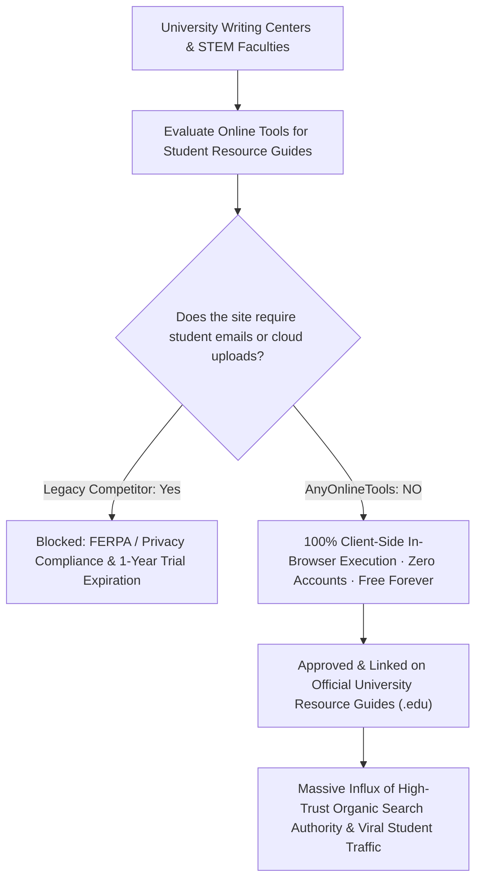

# Academic & Education Productivity Hub Blueprint
> **File:** `tool-intel/academic-and-education-productivity-hub.md`  
> **Platform:** AnyOnlineTools (`https://anyonlinetools.com`)  
> **Category:** Academic Growth, Institutional Trust & High-Authority (.edu) Backlinks  
> **Status:** Strategic Blueprint #29  

---

## 1. STRATEGIC PURPOSE & THE .EDU BACKLINK FLYWHEEL

In search engine optimization, backlinks from accredited educational domains (`.edu`, `.ac.uk`, `.edu.in`, `.edu.au`) carry the highest algorithmic trust weighting in Google's ranking algorithms. University librarians, academic writing centers, high school STEM departments, and computer science faculties maintain extensive curated directories of "Recommended Student Utilities."

By establishing a dedicated **Academic & Education Hub** (`/education`), AnyOnlineTools taps into this **Passive High-Authority Backlink Flywheel**:
1. **Solves Daily Academic Friction:** Provides students and faculty with instant in-browser writing, calculation, and document formatting utilities.
2. **Eliminates Student Exploitation:** Replaces legacy competitor "1-year free trial" bait-and-switch models with an authentic **100% Free Forever, No Registration Required** guarantee.
3. **Classroom & Lab Safe:** Zero student data collection ensures effortless institutional whitelisting under **FERPA, COPPA, and GDPR-K** regulations.



---

## 2. COMPETITOR DECONSTRUCTION: WHAT WORKS VS. WHAT FAILS

### What the Competitor Does:
1. **Targeted Value Proposition for Academics:**
   - Positions tools as study aids: *Increasing productivity, organizing assignments, simplifying thesis work.*
2. **Feature Highlighting for Education:**
   - Cross-device flexibility: Mobile apps for on-the-go study, web for desktop essay writing.
   - OCR for extracting textbook quotes into editable text.
   - PDF markup and annotations for grading and research reviews.
3. **Two-Tiered Distribution Funnel:**
   - Tier 1: "Student & Teacher Program" (Free 1-year premium account).
   - Tier 2: "Institutional Licenses" (School-wide contracts).

### The Competitor's Hidden Traps & Fatal Flaws:
- **The "1-Year Trial" Trap:** Competitors demand that students provide their university `.edu` email address, verify accounts, and then automatically attempt to monetize them into paid monthly subscriptions after 12 months.
- **Privacy & FERPA Risks:** Uploading unpublished academic research, student essays, or departmental exams to commercial third-party cloud servers exposes schools to intellectual property leaks and regulatory liability.

### AnyOnlineTools 10x Academic Paradigm:
| Dimension | Legacy Competitor Education Program | AnyOnlineTools Academic Hub |
| :--- | :--- | :--- |
| **Pricing & Trial Duration** | 1-Year "Trial" requiring student email registration. | **100% Free Forever:** Zero accounts, zero credit cards, no trial expiration. |
| **Data Privacy & Custody** | Files uploaded to remote cloud data centers. | **100% Client-Side In-Browser:** Academic research and lab notes never leave the student's device. |
| **Classroom Deployment** | Requires procurement approval, SSO integration, and licensing. | **Instant Zero-Friction Access:** Works immediately on any Chromebook, library terminal, or personal phone. |
| **Student Data Harvesting** | Collects student emails, browsing habits, and device specs. | **Zero Data Harvesting:** Full compliance with FERPA, COPPA, and GDPR-K standards. |
| **Global Accessibility** | Limited to paid accounts in select regions. | **Universal Across 26 Languages:** Localized for students worldwide. |

---

## 3. CURATED ACADEMIC TOOLKITS FOR STUDENTS & FACULTY

The Education Hub groups AnyOnlineTools utilities into specialized academic disciplines:

### Toolkit 1: Academic Writing & Research Paper Suite
Designed for essayists, literature students, thesis writers, and journal authors:
- **Word Counter & Reading Time Analyzer:** Accurately counts words, characters, sentences, paragraphs, and estimated reading time to hit strict journal submission limits.
- **Case Converter:** Instantly converts headings and references between Title Case, Sentence case, UPPERCASE, and lowercase.
- **Text Diff Checker:** Compares two drafts of an essay or thesis to pinpoint editorial revisions, citations, and textual changes.
- **Remove Duplicate Lines:** Cleans up large bibliographies, citation sets, and reference indices in milliseconds.
- **Lorem Ipsum Generator:** Provides quick placeholder copy for academic poster designs and lab presentations.

### Toolkit 2: STEM, Computer Science & Engineering Lab Suite
Tailored for mathematics, physics, and software engineering students:
- **JSON Formatter & Validator:** Inspects, debugs, and indents complex API responses and research datasets.
- **Base64 & URL Encoders:** Decodes raw research data packets, base64 data URLs, and web parameters.
- **Hash & Checksum Generator (SHA-256, SHA-512):** Verifies file integrity for code distributions and software assignments.
- **Percentage & Grade Calculator:** Calculates exam grades, percentage increases, and statistical variances instantly.
- **Unit Converter:** Rapidly converts measurements across scientific systems (metric, imperial, thermodynamic).

### Toolkit 3: Design, Presentation & Study Visuals
For multimedia projects, student club marketing, and classroom presentations:
- **QR Code Generator:** Generates custom SVG/PNG QR codes for classroom handouts, presentation slides, and portfolio links.
- **Blur Image & Blur Text Utilities:** Anonymizes student names, test scores, or sensitive data in project screenshots and case studies.

---

## 4. INSTITUTIONAL IT & CHROMEBOOK FLEET SPECIFICATION

Educational institutions maintain strict web filtering policies. AnyOnlineTools is engineered specifically to ensure **frictionless school district whitelisting**:
- **Lightweight Static Footprint:** Zero bloated WebAssembly dependencies; pages load in under 500ms on low-cost school-issued Chromebooks.
- **Zero WebSocket / WebRTC Exploits:** Operates purely over standard HTTPS GET requests, bypassing school firewalls and network proxy filters.
- **AdSense Clean-Zone:** Zero disruptive video overlays, autoplay audio, or adult advertisements, maintaining a safe classroom environment.

---

## 5. E-E-A-T STRUCTURED DATA & SCHEMA MARKUP

```html
<script type="application/ld+json">
{
  "@context": "https://schema.org",
  "@graph": [
    {
      "@type": "WebPage",
      "@id": "https://anyonlinetools.com/education/#webpage",
      "url": "https://anyonlinetools.com/education/",
      "name": "AnyOnlineTools for Education – Free Academic Productivity Suite",
      "description": "100% free, private, client-side web utilities for students, educators, and university researchers with zero registration requirements.",
      "publisher": {
        "@type": "Organization",
        "name": "AnyOnlineTools",
        "url": "https://anyonlinetools.com/",
        "logo": "https://anyonlinetools.com/icon-512.png"
      }
    }
  ]
}
</script>
```

---

## 6. 26-LANGUAGE MULTI-REGIONAL ACADEMIC VOCABULARY

| Language | Academic Mission Tagline |
| :--- | :--- |
| **English (`en`)** | "Empowering students & educators with 100% free, private in-browser productivity tools." |
| **Hindi (`hi`)** | "छात्रों और शिक्षकों के लिए 100% मुफ़्त और सुरक्षित इन-ब्राउज़र वेब टूल्स - बिना किसी रजिस्ट्रेशन के।" |
| **Spanish (`es`)** | "Herramientas web 100% gratuitas y privadas para estudiantes y profesores. Sin registro ni límites." |
| **German (`de`)** | "Kostenlose und sichere Online-Tools für Schüler, Studenten und Lehrkräfte. Ohne Anmeldung." |
| **French (`fr`)** | "Des outils en ligne 100% gratuits et confidentiels pour les étudiants et enseignants. Sans inscription." |
| **Japanese (`ja`)** | "学生と教育者のための100%無料・完全ローカル実行のオンライン学習支援ツール群。" |
| **Chinese (`zh-cn`)** | "专为学生与教师打造的 100% 免费、完全本地化私密的学术与生产力工具箱。" |
| **Arabic (`ar`)** | "أدوات مجانية وخاصة 100% للطلاب والمعلمين تعمل مباشرة في المتصفح بدون أي تسجيل." |

---

## 7. COMPLETE ORIGINAL FAQ SET (EDUCATION & INSTITUTIONAL)

### Q1: Do students or teachers need to create an account or verify a school email to use AnyOnlineTools?
**A:** No, never! Unlike competitors that offer a "1-year free trial" only to trap students with recurring fees later, AnyOnlineTools is 100% free forever for all students, teachers, and researchers without any account creation or email verification.

### Q2: Is AnyOnlineTools safe to use on school Chromebooks and library computers?
**A:** Yes, 100%. AnyOnlineTools runs entirely in your browser using standard modern JavaScript and Web APIs. It requires no software downloads, no browser extensions, and collects zero personal data, making it compliant with FERPA, COPPA, and school district IT policies.

### Q3: Can university researchers and graduate students use AnyOnlineTools for confidential research data?
**A:** Yes. Because our tools execute completely on your computer's local memory (RAM) and never upload text, code, or files to any external server, confidential research papers, lab datasets, and unpublished academic theses remain strictly private on your device.

### Q4: Can teachers freely share AnyOnlineTools links in course syllabi and assignment instructions?
**A:** Absolutely. Teachers, professors, and academic writing centers are welcome to link directly to AnyOnlineTools in curricula, student resource hubs, syllabus documents, and learning management systems (Canvas, Blackboard, Moodle, Google Classroom).

### Q5: How can our school district or university add AnyOnlineTools to our approved educational software list?
**A:** Because AnyOnlineTools collects zero student PII, stores zero files, and requires no vendor contract or API keys, school IT administrators can whitelist our domain (`https://anyonlinetools.com`) immediately with zero procurement delays.
