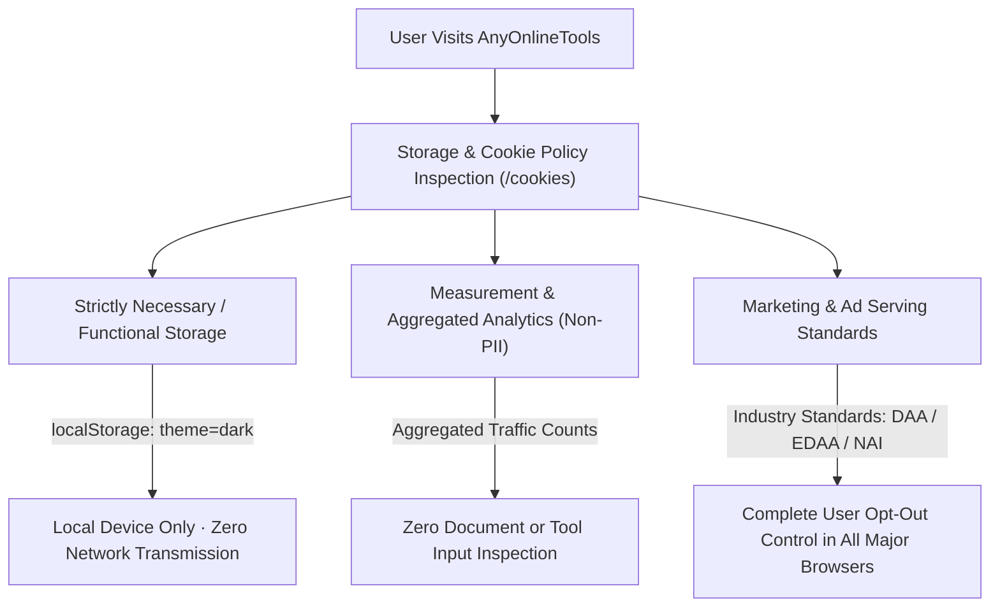

# Cookie Policy & Tracking Transparency Architecture Blueprint
> **File:** `tool-intel/cookie-policy-and-tracking-transparency-standard.md`  
> **Platform:** AnyOnlineTools (`https://anyonlinetools.com`)  
> **Category:** Privacy Infrastructure, ePrivacy Compliance & Tracking Governance  
> **Status:** Strategic Blueprint #28  

---

## 1. STRATEGIC PURPOSE & REGULATORY MANDATE

Modern internet privacy laws—including the European Union ePrivacy Directive (Directive 2002/58/EC as amended), GDPR, and California Privacy Rights Act (CPRA)—mandate that website operators provide full transparency regarding all technologies that store or access information on a user's device (known collectively as "Trackers" or "Cookies").

A world-class **Cookie Policy & Tracking Transparency Hub**:
1. **Ensures AdSense & Partner Ad Compliance:** Satisfies strict Google Publisher Policies and Consent Management Frameworks.
2. **Reassures Privacy-Conscious Developers & Students:** Proves that the platform does not deploy predatory cross-site tracking or stealth fingerprinting scripts.
3. **Demystifies Browser Technologies:** Clearly educates users on the difference between **Functional Local Storage** (e.g., remembering Dark Mode) vs. **Intrusive Third-Party Marketing Cookies**.



---

## 2. COMPETITOR DECONSTRUCTION: WHAT WORKS VS. WHAT FAILS

### What the Competitor Does:
1. **Clear Categorical Division:**
   - *Strictly Necessary / Technical Trackers:* Cloudflare for CDN security and DDoS protection.
   - *Measurement / Analytics Trackers:* Google Analytics 4 (GA4) for aggregate user pathing.
   - *Marketing & Behavioral Trackers:* Google Ad Manager for personalized advertising.
2. **Direct Browser Management Links:**  
   Provides direct documentation links for managing cookies in Google Chrome, Mozilla Firefox, Apple Safari, Microsoft Edge, Brave, and Opera.
3. **Industry Opt-Out Coalition Direct Links:**  
   Links to *YourOnlineChoices* (EU/UK), *Network Advertising Initiative* (US), *Digital Advertising Alliance* (US/Canada), and *AppChoices*.

### Competitor Limitations & Bloat:
- **Heavily Legalese Boilerplate:** Uses generic third-party generator templates (e.g., iubenda) filled with confusing legalese that alienates non-technical users.
- **Invasive Marketing Stacks:** Deploys deep cross-site advertising trackers that profile users across different browsing sessions.

### AnyOnlineTools 10x Clean-Browser Paradigm:
| Parameter | Legacy Competitor | AnyOnlineTools Standard |
| :--- | :--- | :--- |
| **Primary State Mechanism** | Server-side tracking cookies & cross-site tokens | **Lightweight LocalStorage:** Used solely for client-side UI preferences (e.g., Dark Mode). |
| **Tool Input Interception** | Analytics trackers monitor upload filenames and task counts | **Zero Input Tracking:** Tool inputs (text, passwords, images) are never visible to trackers. |
| **Policy Readability** | Obfuscated 15-page legal template | **Transparent, Plain-English Breakdown** with interactive category tables. |
| **Browser Control Guides** | Generic links | **Step-by-step instructions** for Chrome, Firefox, Safari, Edge, Brave, and mobile devices. |
| **Global Languages** | Often English/Spanish only | **Integrated into our 26-language global sitemap matrix**. |

---

## 3. ANYONLINETOOLS TRANSPARENT STORAGE MATRIX

To provide complete transparency, the `/cookies` page details every key used across the application:

| Storage Type | Key / Name | Provider | Purpose | Expiration |
| :--- | :--- | :--- | :--- | :--- |
| **Local Storage** | `theme` | AnyOnlineTools (First-Party) | Remembers user's Dark Mode / Light Mode preference | Persistent (Local device only) |
| **Technical Session** | Transient DOM State | AnyOnlineTools (First-Party) | Holds text repeat count, blur slider, or calculator state | Cleared immediately on tab close |
| **Security / CDN** | Cloudflare (`__cf_bm`) | Cloudflare (Technical) | Distinguishes human users from automated malicious bots | 30 minutes |
| **Performance** | Non-PII Metrics | AnyOnlineTools / CDN | Measures server response times and page load speeds | Session |

---

## 4. COMPREHENSIVE BROWSER CONTROLS & OPT-OUT DIRECTORY

The policy provides direct, practical guidance for users wishing to block or clear cookies:

### 1. Browser-Specific Privacy Controls:
- **Google Chrome:** `Settings > Privacy and security > Third-party cookies`
- **Mozilla Firefox:** `Settings > Privacy & Security > Enhanced Tracking Protection`
- **Apple Safari (macOS & iOS):** `Settings > Safari > Prevent Cross-Site Tracking & Block All Cookies`
- **Microsoft Edge:** `Settings > Cookies and site permissions > Manage and delete cookies`
- **Brave Browser:** `Brave Shields > Trackers & ads blocking (Aggressive/Standard)`
- **Opera:** `Settings > Privacy & Security > Cookies and other site data`

### 2. Global Self-Regulatory Opt-Out Coalitions:
- **United States & Global:** Digital Advertising Alliance (DAA) — [aboutads.info/consumers](https://www.aboutads.info/consumers/)
- **United States (Network Advertisers):** Network Advertising Initiative (NAI) — [optout.networkadvertising.org](https://optout.networkadvertising.org/)
- **European Union & United Kingdom:** European Interactive Digital Advertising Alliance (EDAA) — [youronlinechoices.eu](https://www.youronlinechoices.eu/)
- **Canada:** Digital Advertising Alliance of Canada (DAAC) — [youradchoices.ca](https://youradchoices.ca/)

---

## 5. E-E-A-T STRUCTURED DATA & SCHEMA MARKUP

```html
<script type="application/ld+json">
{
  "@context": "https://schema.org",
  "@graph": [
    {
      "@type": "WebPage",
      "@id": "https://anyonlinetools.com/cookies/#webpage",
      "url": "https://anyonlinetools.com/cookies/",
      "name": "Cookie & Storage Transparency Policy – AnyOnlineTools",
      "description": "Comprehensive guide to how AnyOnlineTools uses browser local storage and minimal technical cookies with zero behavioral profiling.",
      "publisher": {
        "@type": "Organization",
        "name": "AnyOnlineTools",
        "url": "https://anyonlinetools.com/",
        "logo": "https://anyonlinetools.com/icon-512.png"
      }
    }
  ]
}
</script>
```

---

## 6. 26-LANGUAGE MULTI-REGIONAL COOKIE TERMINOLOGY

| Language | Official Cookie Transparency Statement |
| :--- | :--- |
| **English (`en`)** | "We use minimal technical storage solely to remember your UI preferences. Zero behavioral tracking." |
| **Hindi (`hi`)** | "हम केवल आपकी पसंद (जैसे डार्क मोड) को याद रखने के लिए आवश्यक लोकल स्टोरेज का उपयोग करते हैं। कोई जासूसी या ट्रैकिंग नहीं।" |
| **Spanish (`es`)** | "Utilizamos un almacenamiento técnico mínimo únicamente para recordar sus preferencias de interfaz. Cero rastreo conductual." |
| **German (`de`)** | "Wir verwenden minimale technische Speicherungen nur, um Ihre UI-Einstellungen zu speichern. Kein Verhaltens-Tracking." |
| **French (`fr`)** | "Nous utilisons un stockage technique minimal uniquement pour mémoriser vos préférences d'interface. Zéro traçage comportemental." |
| **Japanese (`ja`)** | "ダークモードなどの表示設定を保持するための最小限のローカルストレージのみを使用しています。行動追跡は一切ありません。" |
| **Chinese (`zh-cn`)** | "我们仅使用最少的本地技术存储来保存您的界面偏好（如深色模式）。绝无任何行为追踪。" |
| **Arabic (`ar`)** | "نحن نستخدم الحد الأدنى من التخزين التقني المحلي فقط لتذكر تفضيلاتك (مثل الوضع الداكن). بدون أي تتبع سلوكي." |

---

## 7. COMPLETE ORIGINAL FAQ SET (COOKIES & STORAGE)

### Q1: Does AnyOnlineTools use cookies to track what I type or calculate?
**A:** Absolutely not. All text processing, mathematical calculations, and image editing execute strictly within your local browser memory (RAM). Neither cookies nor our servers have access to your tool inputs or outputs.

### Q2: What information does AnyOnlineTools store in my browser?
**A:** We only use lightweight browser `localStorage` to save your personal UI preferences, specifically whether you have chosen Dark Mode or Light Mode. This setting stays on your device and is never uploaded to any server.

### Q3: Can I use AnyOnlineTools with all cookies and local storage blocked?
**A:** Yes! AnyOnlineTools will function completely normally even if you block all cookies in your browser settings. The only difference is that your Dark Mode setting will revert to your system default when you refresh the page.

### Q4: How does AnyOnlineTools ensure compliance with the EU ePrivacy Directive and GDPR?
**A:** Because we do not deploy non-essential tracking cookies or harvest personal identifiable information, your privacy is safeguarded by architecture. We provide transparent documentation and direct opt-out links for all major browsers and regulatory advertising coalitions.

### Q5: How do I completely clear all stored data from AnyOnlineTools?
**A:** You can clear all data instantly by opening your browser's history or developer tools (`F12 > Application > Storage > Clear site data`) or by using the browser cookie management menus detailed in this policy.
