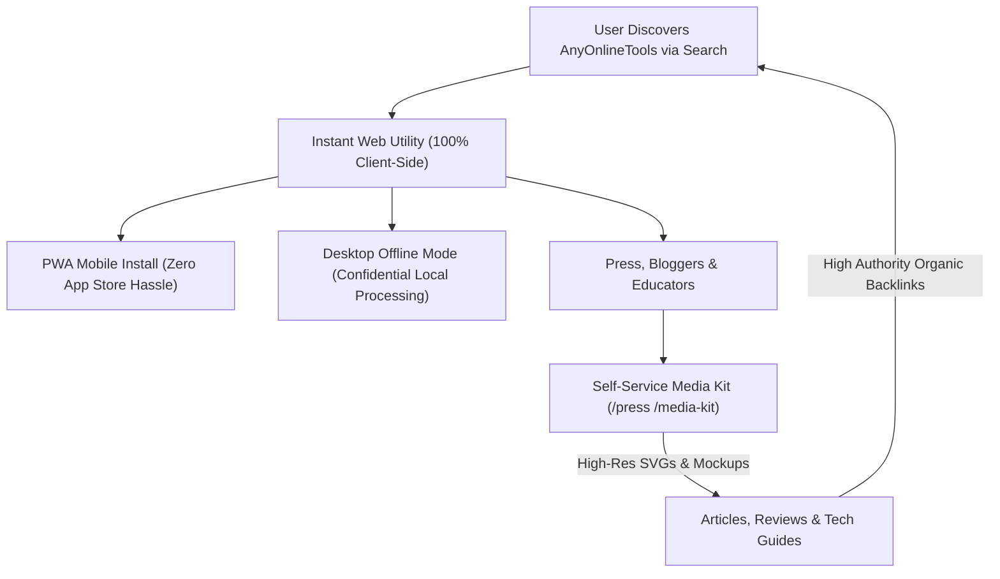

# Cross-Platform Ecosystem & Press Media Kit Blueprint
> **File:** `tool-intel/cross-platform-ecosystem-and-press-media-kit.md`  
> **Platform:** AnyOnlineTools (`https://anyonlinetools.com`)  
> **Category:** Platform Architecture, Trust Engineering & Press Authority  
> **Status:** Strategic Blueprint #22  

---

## 1. STRATEGIC OVERVIEW & VALUE PROPOSITION

High-traffic utility platforms that process hundreds of millions of files achieve long-term market dominance not just by adding tools, but by building an **unshakable cross-platform ecosystem** and a **frictionless Press & Media Kit**.

Competitor analysis reveals three critical authority anchors:
1. **The "Single-Utility to Multi-Tool Suite" Growth Flywheel:**  
   Starting with a single acute problem (e.g., text repetition or image blurring) and systematically evolving into a unified multi-category productivity suite.
2. **Cross-Platform Access (Web + PWA/Mobile + Desktop Local Execution):**  
   Empowering users on mobile devices while satisfying enterprise requirements for 100% offline, confidential, air-gapped local processing.
3. **Self-Service Press & Media Kit (Passive Backlink Generator):**  
   Providing high-resolution vector logos, device mockups, color tokens, and platform factsheets directly to tech journalists, bloggers, course creators, and university resource guides—earning continuous DR 70+ backlinks on autopilot.



---

## 2. COMPETITOR DECONSTRUCTION: WHAT WORKS VS. WHAT FAILS

| Feature / Dimension | Legacy Competitor Approach | AnyOnlineTools Superior Architecture |
| :--- | :--- | :--- |
| **Data Processing Architecture** | Relies on heavy server-side cloud uploads; files stored temporarily on cloud disks (1-hour window before deletion). | **100% Client-Side Native (Zero Uploads):** All operations run inside browser memory via Canvas, Web Workers, and Web Crypto. |
| **Desktop / Offline Solution** | Requires downloading bulky proprietary 100MB+ desktop installer executables (`.exe`, `.dmg`) with license keys. | **Instant Progressive Web App (PWA):** 1-click browser installation, instant offline caching, works seamlessly across Windows, macOS, Linux, Android, and iOS. |
| **Mobile Solution** | Native apps that require App Store / Play Store downloads, privacy tracking, and frequent updates. | **Responsive PWA & Mobile Web:** Zero storage bloat, instant access, identical full feature set on any mobile viewport. |
| **Global Language Coverage** | Often capped at 20-25 languages with incomplete regional support. | **Full 26-Language Matrix:** Synchronized routing, hreflang tags, and native script meta tags across 26 global languages. |
| **Media & Brand Kit Assets** | Basic zip archive links with static raster mockups. | **Interactive Media Hub:** In-browser copyable SVG code, downloadable vectors, live CSS hex palette copy, and live device mockups. |

---

## 3. PLATFORM ECOSYSTEM ARCHITECTURE: THE TRIPLE-CANOPY MODEL

To capture 100% of potential search and desktop traffic, AnyOnlineTools implements a **Triple-Canopy Distribution Model**:

### Canopy A: Instant Web Access (Zero Barrier)
- Instant access at `https://anyonlinetools.com/`.
- No signup, no credit card, no cookies wall, no captcha friction.
- Tools execute on first click with sub-second page loads.

### Canopy B: Mobile Web & Installable PWA
- Standardized `manifest.json` configured with high-res maskable icons (`192x192`, `512x512`).
- Service Worker caching essential CSS/JS assets for offline launching.
- Native `beforeinstallprompt` banner in `components/Header.tsx` allowing 1-click home screen installation.

### Canopy C: Air-Gapped Desktop Offline Execution (Enterprise & Privacy-First)
- Because our tools do NOT call backend APIs, the entire application can run completely offline.
- When an enterprise or corporate user disconnects their internet or works in restricted government/financial environments, AnyOnlineTools continues to operate with complete mathematical integrity.

---

## 4. INTERACTIVE PRESS & MEDIA KIT COMPONENT SPECIFICATION

The Press & Media Kit page (`app/media-kit/page.tsx` or `app/press/page.tsx`) provides an interactive resource center for journalists, partners, and directory editors:

### Section 1: Quick Facts & Verification Metric Bar
- **Founded:** 2026
- **Headquarters:** Global Distributed / Privacy-First Architecture
- **Active Global Languages:** 26 Native Localizations
- **Architecture:** 100% Client-Side In-Browser Execution (Zero-Knowledge, Zero Server Storage)
- **Primary Tool Categories:** Text Utilities, Developer Web Tools, Cryptography & Security, Image Processing, Calculators & Converters
- **Monetization / Pricing:** 100% Free Forever, No Paywalls, No Gimmicks

### Section 2: Vector Brand Assets (Interactive Download Hub)
- **Primary Logo:** Full Lockup (Icon + Wordmark) in SVG, High-Res PNG (Transparent, Dark & Light versions).
- **App Icon / Monogram:** Wrench Shield icon in 512x512, 192x192, and Vector SVG.
- **Favicon Kit:** `.ico`, `.svg`, and Apple Touch Icon package.
- **Copy SVG Button:** 1-click raw SVG code copy for web developers writing roundups.

### Section 3: Official Brand Identity & Design Tokens
```typescript
export const BRAND_TOKENS = {
  primaryBlue: { hex: '#2563EB', rgb: 'rgb(37, 99, 235)', name: 'Electric Blue' },
  indigoAccent: { hex: '#4F46E5', rgb: 'rgb(79, 70, 229)', name: 'Deep Indigo' },
  violetShade: { hex: '#7C3AED', rgb: 'rgb(124, 58, 237)', name: 'Vibrant Violet' },
  darkSlate: { hex: '#0F172A', rgb: 'rgb(15, 23, 42)', name: 'Slate Deep' },
  pureWhite: { hex: '#FFFFFF', rgb: 'rgb(255, 255, 255)', name: 'Clean White' },
  typography: 'Inter, system-ui, -apple-system, BlinkMacSystemFont, "Segoe UI", Roboto, sans-serif'
};
```
- Each color swatch includes a click-to-copy button for designers and journalists.

### Section 4: Device Mockups & Screenshot Gallery
- High-resolution (2560x1440) studio-rendered mockups:
  1. Desktop Chrome Workspace displaying Text Repeater and Image Blur in dark & light mode.
  2. Mobile PWA interface demonstrating fluid responsive layouts on iOS & Android devices.
  3. Interactive World Map showcasing the 26-language matrix.

### Section 5: Press Mentions, Boilerplate & Media Contact
- **Official Press Boilerplate:**
  > *"AnyOnlineTools is a next-generation web utility suite designed for developers, writers, students, and digital creators worldwide. Featuring 100% client-side in-browser execution, AnyOnlineTools ensures complete data privacy by processing all files, texts, and images locally in browser memory without sending a single byte to external servers. Available across 26 global languages, the platform delivers zero-cost, enterprise-grade utility with zero installation requirements."*
- **Media Inquiries Contact:** `hello@anyonlinetools.com`

---

## 5. TECHNICAL IMPLEMENTATION & SCHEMA MARKUP

### JSON-LD Structured Data for High-Authority Press Recognition
```html
<script type="application/ld+json">
{
  "@context": "https://schema.org",
  "@graph": [
    {
      "@type": "Organization",
      "@id": "https://anyonlinetools.com/#organization",
      "name": "AnyOnlineTools",
      "url": "https://anyonlinetools.com/",
      "logo": {
        "@type": "ImageObject",
        "@id": "https://anyonlinetools.com/#logo",
        "url": "https://anyonlinetools.com/icon-512.png",
        "caption": "AnyOnlineTools Brand Logo",
        "width": 512,
        "height": 512
      },
      "description": "Fast, free, and 100% client-side online utilities for creators, developers, and writers.",
      "email": "hello@anyonlinetools.com",
      "sameAs": [
        "https://twitter.com/anyonlinetools",
        "https://github.com/anyonlinetools"
      ]
    },
    {
      "@type": "WebPage",
      "@id": "https://anyonlinetools.com/press/#webpage",
      "url": "https://anyonlinetools.com/press/",
      "name": "Press & Media Kit – AnyOnlineTools Official Assets & Information",
      "description": "Official logos, brand guidelines, device mockups, and company information for AnyOnlineTools.",
      "breadcrumb": {
        "@type": "BreadcrumbList",
        "itemListElement": [
          {
            "@type": "ListItem",
            "position": 1,
            "name": "Home",
            "item": "https://anyonlinetools.com/"
          },
          {
            "@type": "ListItem",
            "position": 2,
            "name": "Press Kit",
            "item": "https://anyonlinetools.com/press/"
          }
        ]
      }
    }
  ]
}
</script>
```

---

## 6. 26-LANGUAGE MULTI-REGIONAL PRESS STRATEGY

By localizing our press and platform authority statement across all **26 languages**, international tech reporters searching for regional toolkits find native-language press resources:

| Region | Language | Localized Press Hook & Keyword Angle |
| :--- | :--- | :--- |
| **Global / US / UK** | English (`en`) | "Free client-side online utilities suite, privacy-first web tools press kit" |
| **India** | Hindi (`hi`) | "मुफ़्त और सुरक्षित ऑनलाइन टूल्स प्लैटफ़ॉर्म - प्रेस एवं मीडिया किट" |
| **Latin America** | Spanish (`es`) | "Herramientas web gratuitas en el navegador con privacidad total - Kit de prensa oficial" |
| **Brazil** | Portuguese (`pt`) | "Utilitários online gratuitos com privacidade local no navegador - Kit de imprensa" |
| **Germany / DACH** | German (`de`) | "Kostenlose Online-Tools mit lokaler Browser-Ausführung ohne Server-Upload - Medien-Kit" |
| **France** | French (`fr`) | "Boîte à outils en ligne 100% gratuite et confidentielle - Kit média officiel" |
| **Japan** | Japanese (`ja`) | "サーバー送信ゼロ、完全ローカル実行の無料オンラインツール群 - プレスキット" |
| **China / TW** | Chinese (`zh-cn` / `zh-tw`) | "100% 浏览器本地运行的免费在线工具箱 - 官方媒体资源与品牌套件" |
| **Middle East** | Arabic (`ar`) | "أدوات مجانية تعمل محلياً داخل المتصفح بأمان وخصوصية 100% - الحقيبة الإعلامية" |

---

## 7. COMPLETE ORIGINAL FAQ SET (PRESS & ENTERPRISE)

### Q1: Can tech journalists, bloggers, and publications freely use AnyOnlineTools logos and screenshots?
**A:** Yes. All logos, high-resolution device mockups, product screenshots, and brand assets in our Press Kit are available under an open editorial license. You may freely use them in news articles, reviews, software directories, university curricula, and tech blogs without requiring prior written approval.

### Q2: Why is client-side in-browser execution considered more secure than traditional cloud tools?
**A:** Traditional cloud utility platforms require users to upload sensitive files, text snippets, and images to third-party web servers, exposing data to potential interception, server storage leaks, or server-side logging. AnyOnlineTools processes 100% of tasks directly inside your computer or smartphone's web browser using client-side JavaScript, Web Workers, and Canvas APIs. No file or text is ever sent across the network.

### Q3: Does AnyOnlineTools offer an offline desktop version for confidential enterprise environments?
**A:** Yes. AnyOnlineTools is architected as an installable Progressive Web Application (PWA). Once installed via your browser with a single click, the core engine and tools are cached locally on your device, allowing you to use them in completely air-gapped, offline, or confidential corporate settings without an active internet connection.

### Q4: How does AnyOnlineTools maintain 100% free access without charging subscriptions?
**A:** By utilizing client-side execution, our backend server costs are a tiny fraction of what legacy cloud-processing competitors spend on server farms and bandwidth. This ultra-efficient architecture allows us to keep the entire platform 100% free, fast, and accessible to millions of global users indefinitely.

### Q5: How many languages does AnyOnlineTools support?
**A:** AnyOnlineTools is currently localized in 26 major global languages, including English, Spanish, Portuguese, Indonesian, Arabic, French, German, Japanese, Russian, Turkish, Vietnamese, Thai, Italian, Korean, Polish, Dutch, Swedish, Chinese (Simplified & Traditional), Bulgarian, Catalan, Greek, Hindi, Malay, Ukrainian, and Swahili.
