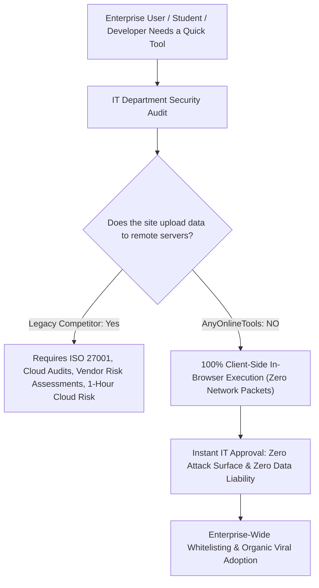

# Enterprise Security, Compliance & Trust Architecture Blueprint
> **File:** `tool-intel/enterprise-security-compliance-and-trust-architecture.md`  
> **Platform:** AnyOnlineTools (`https://anyonlinetools.com`)  
> **Category:** Enterprise Trust, Data Protection & Regulatory Compliance  
> **Status:** Strategic Blueprint #25  

---

## 1. STRATEGIC PURPOSE & ENTERPRISE TRUST PSYCHOLOGY

Enterprise IT administrators, university technology directors, healthcare compliance officers, and legal teams have strict procurement rules prohibiting employees from uploading company documents, passwords, or code snippets to unverified web utilities.

When a digital utility platform provides a formal **Security, Privacy & Data Protection Framework**, it transforms from a simple consumer website into an **enterprise-approved productivity asset**.



---

## 2. COMPETITOR DECONSTRUCTION: WHAT WORKS VS. WHAT FAILS

### What the Competitor Does:
1. **Formal Compliance Badging:** ISO/IEC 27001:2022 certification, European GDPR conformity, eIDAS Qualified Trust Service Provider (QTSP) integration.
2. **Multi-Tiered Security Breakdown:**
   - *Data Privacy:* Deletion after 1 hour, HTTPS transmission.
   - *Cloud Infrastructure:* Elastic cloud partners, global CDN DDoS protection.
   - *Internal Security Controls:* Centralized account management, 90-day password rotation, mandatory 2FA, physical facility biometric locks, Principle of Least Privilege.

### The Competitor's Fatal Architectural Flaw:
The competitor is forced to spend millions on complex physical security, biometric facility access, fire protection, and employee onboarding checklists **because they store user files on centralized cloud servers**. If an employee goes rogue or a server is misconfigured, user documents can be compromised.

### AnyOnlineTools 10x Superior Paradigm:
> **"The Most Secure Cloud Server is No Cloud Server."**
> AnyOnlineTools does not require biometric facility guards to protect your documents because **your documents never enter our building, our servers, or our cloud**.
> All computations are executed 100% locally within your device's browser memory (RAM) using standard Web APIs.

---

## 3. COMPLIANCE & DATA PROTECTION MATRIX

| Regulatory / Security Dimension | Legacy Competitor Cloud Stack | AnyOnlineTools Client-Side Architecture |
| :--- | :--- | :--- |
| **GDPR (EU 2016/679) Compliance** | Complies via post-upload data deletion protocols (1-hour window). | **Inherent Compliance by Design:** Article 5(1)(c) "Data Minimization" taken to the theoretical limit: 0 bytes collected. |
| **Data Subject Rights (Access / Erasure)** | Users must request manual deletion if needed before the 1-hour window. | **Instant Automatic Erasure:** Closing the browser tab or reloading immediately purges all RAM memory. |
| **Subpoena & Government Seizure Immunity** | Servers can be legally compelled to log or retain user traffic. | **Mathematically Impossible:** AnyOnlineTools maintains zero databases of user inputs or files. |
| **Network Interception Risk** | High: Files travel across ISPs and public internet backbones to cloud data centers. | **Zero Network Exposure:** Files never leave the localhost machine. |
| **Offline / Air-Gapped Usability** | Fails or requires bulky proprietary desktop app downloads. | **Native PWA Execution:** Runs completely offline without any internet connection. |

---

## 4. MULTI-LAYERED TECHNICAL SECURITY SPECIFICATIONS

### Layer 1: Browser-Level Client Isolation
- All data manipulation runs in isolated JavaScript execution contexts.
- Heavy computations are delegated to client-side **Web Workers** to prevent UI thread freezing.
- Image rendering and text masking run on hardware-accelerated **HTML5 Canvas** buffers that never make network calls.

### Layer 2: Network & Transport Security (Strict HSTS & HTTPS)
- **TLS 1.3 Strict Enforcement:** Legacy, vulnerable SSL/TLS protocols are strictly rejected.
- **HSTS (HTTP Strict Transport Security):** Enforces encrypted HTTPS connections with `max-age=31536000; includeSubDomains; preload`.

### Layer 3: Modern HTTP Defense-in-Depth Headers (`.htaccess` & Static CDN)
```apache
Header set X-Content-Type-Options "nosniff"
Header set X-Frame-Options "SAMEORIGIN"
Header set X-XSS-Protection "1; mode=block"
Header set Referrer-Policy "strict-origin-when-cross-origin"
Header set Permissions-Policy "geolocation=(), microphone=(), camera=()"
Header set Content-Security-Policy "default-src 'self'; script-src 'self' 'unsafe-inline'; style-src 'self' 'unsafe-inline'; img-src 'self' data: blob:;"
```

---

## 5. E-E-A-T STRUCTURED DATA & SCHEMA MARKUP

```html
<script type="application/ld+json">
{
  "@context": "https://schema.org",
  "@graph": [
    {
      "@type": "WebPage",
      "@id": "https://anyonlinetools.com/privacy/#security-policy",
      "url": "https://anyonlinetools.com/privacy/",
      "name": "Security, Compliance & Data Protection Standards – AnyOnlineTools",
      "description": "Comprehensive security overview of AnyOnlineTools client-side architecture, zero-server data retention, and GDPR compliance.",
      "publisher": {
        "@type": "Organization",
        "name": "AnyOnlineTools",
        "url": "https://anyonlinetools.com/",
        "logo": "https://anyonlinetools.com/icon-512.png"
      }
    }
  ]
}
</script>
```

---

## 6. 26-LANGUAGE MULTI-REGIONAL SECURITY VOCABULARY

To ensure global compliance readiness, core data protection principles are aligned across all 26 supported languages:

| Language | Primary Security Principle |
| :--- | :--- |
| **English (`en`)** | "100% Client-Side In-Browser Execution · Zero Cloud Storage · Complete Privacy" |
| **Hindi (`hi`)** | "100% इन-ब्राउज़र लोकल प्रोसेसिंग · ज़ीरो सर्वर स्टोरेज · संपूर्ण डेटा गोपनीयता" |
| **Spanish (`es`)** | "Procesamiento 100% local en el navegador · Cero almacenamiento en el servidor · Privacidad total" |
| **German (`de`)** | "100% lokale Ausführung im Browser · Keine Serverspeicherung · Vollständiger Datenschutz" |
| **French (`fr`)** | "Traitement 100% local dans le navigateur · Aucun stockage sur serveur · Confidentialité totale" |
| **Japanese (`ja`)** | "100% ブラウザ内ローカル処理 · サーバー保存ゼロ · 完全なプライバシー保護" |
| **Chinese (`zh-cn`)** | "100% 浏览器本地运行 · 零服务器存储 · 绝对隐私安全保障" |
| **Arabic (`ar`)** | "معالجة محلية 100% داخل المتصفح · بدون تخزين على الخوادم · خصوصية وأمان تام" |

---

## 7. COMPLETE ORIGINAL FAQ SET (ENTERPRISE IT & SECURITY)

### Q1: Can employees at regulated enterprises (finance, healthcare, legal) safely use AnyOnlineTools?
**A:** Yes. Unlike legacy cloud conversion tools that upload files to third-party data centers, AnyOnlineTools performs all calculations, text parsing, and file handling locally in browser memory. Sensitive documents, proprietary code, and personal data never leave the user's workstation.

### Q2: Does AnyOnlineTools maintain any server logs or copies of processed data?
**A:** No. Our backend servers act strictly as a static content delivery network (CDN) to serve HTML, CSS, and JavaScript files. When you interact with a tool, the data never reaches our servers; therefore, it is technically impossible for us to log, inspect, or retain your data.

### Q3: How does AnyOnlineTools comply with the European Union General Data Protection Regulation (GDPR)?
**A:** AnyOnlineTools complies with GDPR Article 5(1)(c) ("Data Minimization") by not collecting, processing, or storing personal data in the first place. Because no user files or identities are collected on our servers, there is zero risk of data breaches, unauthorized transfers, or third-party tracking.

### Q4: Does AnyOnlineTools require user registration, passwords, or credit card details?
**A:** No. AnyOnlineTools does not require accounts, logins, or payment details. By eliminating user accounts, we eliminate the security vulnerabilities associated with credential stuffing, password leaks, or database breaches.

### Q5: Can AnyOnlineTools be operated in an air-gapped or offline network?
**A:** Yes. By installing AnyOnlineTools as a Progressive Web Application (PWA), the entire utility suite is cached on your device. You can disconnect from the internet or work within restricted intranet environments with full functionality.
