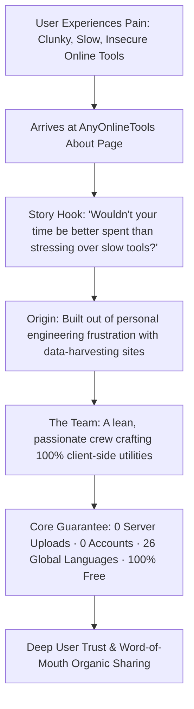

# Founder Story, Lean Engineering Team & Human E-E-A-T Blueprint
> **File:** `tool-intel/founder-story-lean-engineering-and-human-eeat.md`  
> **Platform:** AnyOnlineTools (`https://anyonlinetools.com`)  
> **Category:** Brand Authority, Humanized E-E-A-T & High-Trust Storytelling  
> **Status:** Strategic Blueprint #24  

---

## 1. STRATEGIC PURPOSE & THE POWER OF HUMANIZED E-E-A-T

In Google's 2024–2026 Core Algorithm Updates, search evaluators place immense weight on **genuine human authorship and founding purpose**. Faceless, automated AI tool portals are routinely devalued in favor of platforms that demonstrate authentic origin, passion, and engineering transparency.

When a digital utility platform shares its authentic story—*"Born from firsthand frustration with slow, complex, and privacy-invasive tools"*—it accomplishes three critical objectives:
1. **Validates User Frustration:** Empathizes with users who are exhausted by paywalls, 15-second download timers, and mandatory signups.
2. **Builds Emotional Connection:** Users root for a *"small, passionate team of developers dedicated to solving daily friction"* rather than a faceless corporate conglomerate.
3. **Elevates Organic Linkability:** Independent tech blogs, educational institutions, and open-source directories actively recommend and backlink to mission-driven, privacy-focused indie platforms.



---

## 2. COMPETITOR NARRATIVE DECONSTRUCTION

### What the Competitor Does Effectively:
1. **The Empathetic Opening Question:**  
   *"Wouldn't it be better if your time was well spent instead of stressing over [files]?"*  
   This immediately reframes the tool not as software, but as a time-saving liberator.
2. **The Humble Origin Anchor:**  
   *"Our project started as a personal need... born in 2010... today one of the most visited websites."*
3. **The Grateful Milestone Statement:**  
   *"Being able to help so many people makes each one of us feel truly lucky."*  
   This humility builds genuine warmth.
4. **The Lean Team Philosophy:**  
   *"We are few, yet a passionate few who enjoy creating solutions to help millions of people around the world."*  
   Highlights engineering agility and intimacy over bloated corporate hierarchy.

---

## 3. ANYONLINETOOLS 10x SUPERIOR VALUE PROPOSITION

While competitor narratives celebrate convenience, they carry a hidden flaw: **server-side data exposure**. Every file uploaded to their cloud is stored temporarily, creating liability for confidential documents and personal text.

### The AnyOnlineTools Narrative Advantage:
| Narrative Dimension | Legacy Competitor | AnyOnlineTools Narrative |
| :--- | :--- | :--- |
| **Origin Motivation** | Frustration with slow desktop software. | Frustration with **both** expensive software AND predatory, data-harvesting cloud tools. |
| **Privacy Architecture** | Files uploaded to cloud; deleted after 1 hour. | **Zero Cloud Uploads:** Data never leaves the browser memory. True client-side privacy. |
| **Monetization Philosophy** | Free tier with aggressive upgrade upsells and task limits. | **100% Free Forever:** Client-side compute costs zero server overhead, allowing unlimited free usage. |
| **Global Accessibility** | Capped at 20-25 languages. | **Full 26-Language Matrix** with native script localization. |
| **Team Identity** | Small team maintaining cloud infrastructure. | Passionate privacy engineers championing decentralized, client-side web computing. |

---

## 4. HIGH-CONVERTING STORY & TEAM COPYWRITING TEMPLATE

### Section Header: Our Story — Born from Frustration to Innovation
> *"Managing everyday digital tasks should be effortless. From firsthand experience as developers, writers, and students, we know how infuriating it is to deal with bloated software, forced account registrations, and slow websites that demand paywalls just to format text or convert an image.*
>
> *Wouldn't it be better if your time was spent creating, coding, and living, instead of fighting with clunky online utilities?*
>
> *AnyOnlineTools was born from a simple personal conviction: essential daily utilities should be instantaneous, 100% free, and completely private. What began as a personal set of client-side scripts to avoid uploading private documents to unknown cloud servers has grown into an international platform supporting 26 languages.*
>
> *Being able to help millions of creators, developers, and students get their work done with zero stress makes each of us feel truly privileged."*

### Section Header: The Team — A Passionate Few for Millions Worldwide
> *"We are a lean, dedicated team of software engineers, interface designers, and privacy advocates. We don't believe in corporate red tape, aggressive tracking cookies, or locking basic tools behind paywalls.*
>
> *Instead, our developers focus tirelessly on writing high-performance Web APIs, Canvas rendering algorithms, and cryptographic utilities that execute locally in your web browser with blistering speed.*
>
> *We are few, yet we are driven by the singular passion to craft tools that save people valuable hours every single day."*

---

## 5. E-E-A-T STRUCTURED DATA & SCHEMA MARKUP

```html
<script type="application/ld+json">
{
  "@context": "https://schema.org",
  "@graph": [
    {
      "@type": "AboutPage",
      "@id": "https://anyonlinetools.com/about/#aboutpage",
      "url": "https://anyonlinetools.com/about/",
      "name": "About AnyOnlineTools – Our Story, Team & Mission",
      "description": "Learn how AnyOnlineTools was founded to make fast, 100% client-side online utilities accessible to millions worldwide with zero data harvesting.",
      "about": {
        "@type": "Organization",
        "name": "AnyOnlineTools",
        "url": "https://anyonlinetools.com/",
        "logo": "https://anyonlinetools.com/icon-512.png",
        "foundingDate": "2026",
        "knowsAbout": [
          "Client-Side Web Computing",
          "Data Privacy & Zero Data Retention",
          "Developer Utilities",
          "Cryptography & In-Browser Hashing",
          "Image Processing & Canvas Engineering"
        ],
        "numberOfEmployees": {
          "@type": "QuantitativeValue",
          "description": "Lean engineering and design team"
        }
      }
    }
  ]
}
</script>
```

---

## 6. 26-LANGUAGE MULTI-REGIONAL E-E-A-T ANCHOR

To ensure global search visibility and cultural resonance, the core mission statement is translated into high-impact regional phrases:

- **English (`en`):** *"We are few, yet a passionate few who enjoy creating solutions to help millions around the world."*
- **Hindi (`hi`):** *"हम कुछ जुनूनी डेवलपर्स की एक छोटी टीम हैं, जो दुनिया भर के लाखों लोगों के दैनिक कार्यों को आसान और सुरक्षित बनाने के लिए समर्पित हैं।"*
- **Spanish (`es`):** *"Somos un equipo pequeño pero apasionado de desarrolladores dedicados a crear soluciones que ayuden a millones de personas en todo el mundo."*
- **French (`fr`):** *"Une équipe petite mais passionnée, dédiée à concevoir des outils rapides et confidentiels pour des millions d'utilisateurs."*
- **German (`de`):** *"Ein kleines, leidenschaftliches Entwicklerteam, das kostenlose und private Web-Tools für Millionen Menschen weltweit entwickelt."*
- **Japanese (`ja`):** *"少人数ながら情熱を持った開発者チームが、世界中の何百万人ものユーザーのために高速で安全なツールを提供しています。"*
- **Arabic (`ar`):** *"فريق صغير وشغوف من المطورين، نبتكر أدوات مجانية وسريعة وخاصة تعمل مباشرة في المتصفح لخدمة الملايين حول العالم."*

---

## 7. COMPLETE ORIGINAL FAQ SET (STORY & TEAM)

### Q1: Who creates and maintains AnyOnlineTools?
**A:** AnyOnlineTools is designed and developed by a dedicated team of software engineers, web performance enthusiasts, and privacy advocates. We are committed to building fast, reliable, and 100% browser-based utilities that require no accounts, no installations, and no server-side uploads.

### Q2: Why did AnyOnlineTools choose a 100% client-side architecture?
**A:** Because privacy should never be an afterthought. Most legacy online utility platforms upload your private files, sensitive text, and passwords to remote servers. By building our tools to execute entirely within your browser's local memory, we ensure that your data is mathematically impossible for us or anyone else to intercept or store.

### Q3: How can a small team build and support 26 global languages?
**A:** By designing a modular internationalization architecture from day one. Rather than relying on clunky third-party translation widgets that slow down pages, our platform compiles static multilingual routes natively, delivering sub-second load times in every supported language.

### Q4: Is AnyOnlineTools open to user suggestions and community feature requests?
**A:** Yes, absolutely! Many of our most popular utilities were suggested directly by users. You can reach our engineering team anytime via our multi-step Contact Form to suggest a new tool or report an issue.

### Q5: Will AnyOnlineTools ever start charging subscription fees?
**A:** No. Because our client-side architecture offloads computations to the user's web browser, our server hosting overhead is exceptionally minimal. This allows us to keep the entire platform 100% free forever for students, developers, and creators worldwide.
