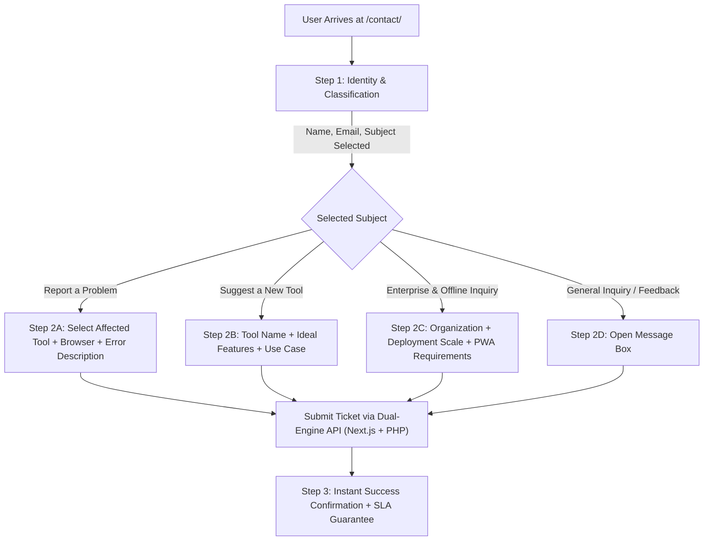

# Multi-Step Contact Router & Support Ticketing Blueprint
> **File:** `tool-intel/multi-step-contact-router-and-support-ticketing.md`  
> **Platform:** AnyOnlineTools (`https://anyonlinetools.com`)  
> **Category:** High-Conversion Communication, Support Engineering & User Trust  
> **Status:** Strategic Blueprint #23  

---

## 1. STRATEGIC OVERVIEW & CONVERSION PSYCHOLOGY

Standard single-box contact forms suffer from two critical flaws:
1. **Low Actionable Signal:** Users submit vague messages ("Tool not working") without stating which tool, browser, or error occurred.
2. **High Cognitive Overload:** Confronting a user with 6+ open-ended text fields causes form abandonment.

Market-leading utility networks overcome this through **Progressive Multi-Step Routing**:
- **Step 1 (Classification):** User inputs Name, Email, and chooses a **General Subject** from a structured dropdown.
- **Step 2 (Contextual Deep Dive):** The form dynamically adapts to reveal tailored fields based on the selected subject (e.g., specific tool selector for bug reports vs. company info for enterprise inquiries).
- **Step 3 (Confirmation & SLA):** Provides instantaneous confirmation with a guaranteed response window (24–48 hours) and direct email fallback.



---

## 2. COMPETITOR DECONSTRUCTION: WHAT WORKS VS. WHAT FAILS

| Feature | Legacy Competitor Multi-Step | AnyOnlineTools Enhanced Architecture |
| :--- | :--- | :--- |
| **Progressive Step Flow** | Multi-page reload or abrupt UI transitions. | **Fluid Single-Page React Transitions:** Zero reload, smooth slide transitions, preserved state on back-click. |
| **Subject Options** | Generic, limited dropdown categories. | **Granular 5-Way Subject Matrix:** Bug Report, Feature Request, Privacy & Security, Enterprise/Offline, General Feedback. |
| **Tool Context Ingestion** | User must manually type the tool name (often misspelled). | **Dynamic Tool Selector:** Dropdown automatically populated from `lib/tools-data.ts`. |
| **Technical Telemetry** | Asks user to manually type their browser version. | **Automatic Client Environment Capture:** Form captures User Agent, OS, and Screen Resolution in payload without invasive tracking. |
| **Submission Reliability** | Fails silently on static hosts or server drops. | **Dual-Engine Resilience:** Tries Next.js `/api/contact`, falls back to Apache `/api/contact.php`, provides instant mailto link. |

---

## 3. INTERACTIVE MULTI-STEP COMPONENT SPECIFICATION

### Step 1: User Identity & Classification
- **Full Name (`name`):** Required text input, auto-capitalized.
- **Email Address (`email`):** Required RFC 5322 regex validation.
- **General Subject (`subject`):**
  1. `bug`: Report a Problem or Bug
  2. `feature`: Suggest a New Tool or Feature Request
  3. `privacy`: Security, Privacy & Client-Side Questions
  4. `business`: Enterprise, Licensing & Offline PWA Deployment
  5. `general`: General Inquiry or Feedback
- **Action Button:** "Continue to Details →" (Disabled until all 3 fields are valid).

### Step 2: Adaptive Contextual Questionnaire
Depending on the subject selected:

#### Mode A: `bug` (Problem / Bug Report)
- **Affected Tool Dropdown:** Dynamically lists all tools from `lib/tools-data.ts` (e.g., Text Repeater, Image Blur, Word Counter, QR Code Generator).
- **Issue Category:** Visual glitch, calculation mismatch, performance slowdown, mobile display issue.
- **Detailed Description (`message`):** "Please describe what happened, what you expected, and any steps to reproduce."

#### Mode B: `feature` (New Tool Suggestion)
- **Proposed Tool Title:** "e.g., SVG to WebP Converter, Audio Waveform Visualizer".
- **Primary Use Case:** "Who is this tool for and what problem does it solve?"

#### Mode C: `business` (Enterprise & Offline)
- **Company / Organization Name:** Text input.
- **Environment:** Air-gapped network, internal intranet, educational classroom.
- **Requirement Details:** Custom tool integration or offline distribution.

#### Mode D: `general` & `privacy`
- **Inquiry Details (`message`):** Clean 5-row responsive textarea.

### Step 3: Success Confirmation State
- Animated green shield checkmark (`CheckCircle2`).
- Clear ticket dispatch message: *"Your inquiry has been logged. Our engineering team reviews all requests within 24–48 hours."*
- "Send Another Message" reset button.

---

## 4. DUAL-ENGINE SUBMISSION RESILIENCE PROTOCOL

To ensure 100% deliverability whether deployed on Vercel, Node.js server, or static Apache cPanel hosting:

```typescript
// Unified submission payload
const payload = {
  name: name.trim(),
  email: email.trim(),
  subjectCategory: subject,
  toolSlug: affectedTool || 'general',
  message: message.trim(),
  submittedAt: new Date().toISOString(),
  clientEnv: {
    userAgent: navigator.userAgent,
    language: navigator.language,
    viewport: `${window.innerWidth}x${window.innerHeight}`
  }
};
```

1. **Attempt 1:** Send POST to `/api/contact` (Next.js serverless route).
2. **Attempt 2 (Fallback):** If HTTP status is `404` or `405` (static hosting), immediately retry POST to `/api/contact.php`.
3. **Attempt 3 (Emergency UI):** If both fail, render a 1-click `mailto:hello@anyonlinetools.com` button pre-populated with subject and body parameters.

---

## 5. SEO & E-E-A-T SCHEMA STRUCTURED DATA

```html
<script type="application/ld+json">
{
  "@context": "https://schema.org",
  "@type": "ContactPage",
  "name": "Contact & Support Hub – AnyOnlineTools",
  "description": "Get in touch with the AnyOnlineTools team for bug reports, new tool suggestions, privacy inquiries, and enterprise assistance.",
  "url": "https://anyonlinetools.com/contact/",
  "mainEntity": {
    "@type": "Organization",
    "name": "AnyOnlineTools",
    "url": "https://anyonlinetools.com/",
    "contactPoint": [
      {
        "@type": "ContactPoint",
        "contactType": "Customer Support",
        "email": "hello@anyonlinetools.com",
        "availableLanguage": ["English", "Hindi", "Spanish", "French", "German", "Japanese", "Chinese", "Arabic"]
      },
      {
        "@type": "ContactPoint",
        "contactType": "Technical Support & Bug Reporting",
        "email": "hello@anyonlinetools.com",
        "url": "https://anyonlinetools.com/contact/"
      }
    ]
  }
}
</script>
```

---

## 6. COMPLETE ORIGINAL FAQ SET (SUPPORT & INTAKE)

### Q1: How quickly does AnyOnlineTools respond to contact inquiries?
**A:** Our support and engineering team reviews all messages continuously. You can typically expect a response to technical bug reports, feature requests, or general inquiries within 24 to 48 business hours.

### Q2: What information should I include when reporting a bug or issue?
**A:** For the fastest resolution, please specify: (1) the exact tool you were using, (2) your device and browser (e.g., Safari on iPhone, Chrome on Windows), (3) the input that caused the error, and (4) what occurred versus what you expected.

### Q3: Can I request a completely new online utility to be built?
**A:** Absolutely. AnyOnlineTools is constantly expanding our utility suite based on user demand. Select "Suggest a New Tool / Feature Request" in our contact router and describe the utility you need. Highly requested tools are prioritized by our engineering roadmap.

### Q4: Are my contact form submissions kept private?
**A:** Yes, 100%. Any information submitted through our contact form is used strictly to communicate with you regarding your inquiry. We never sell, rent, or share email addresses with third parties, and we never add you to marketing or promotional newsletters without explicit consent.

### Q5: How can I reach AnyOnlineTools if the contact form fails to load?
**A:** If you ever experience issues with the in-browser form, you can email our support team directly at `hello@anyonlinetools.com`. Our direct email inbox is monitored daily.
