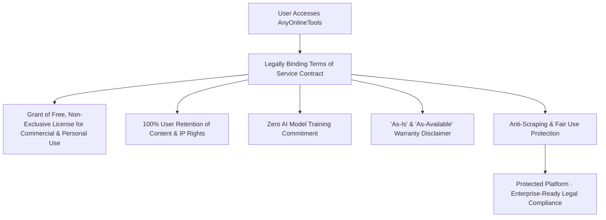

# SaaS Terms of Service & AI Utility Legal Architecture Blueprint
> **File:** `tool-intel/saas-terms-of-service-and-ai-utility-contract.md`  
> **Platform:** AnyOnlineTools (`https://anyonlinetools.com`)  
> **Category:** Legal Infrastructure, Platform Terms & AI Governance  
> **Status:** Strategic Blueprint #27  

---

## 1. STRATEGIC PURPOSE & LEGAL RISK MITIGATION

Online utility platforms that process millions of user inputs (text manipulations, file conversions, mathematical calculations, and image transformations) require an airtight **Terms of Service (ToS)** contract to achieve three vital goals:
1. **Shield Platform from Liability:** Clear "As-Is" disclaimers preventing claims regarding calculation errors, output reliance, or data loss.
2. **User Intellectual Property Protection:** Affirming that users retain 100% exclusive copyright and ownership of all content processed through the tools.
3. **AI Era Governance & Anti-Scraping:** Explicit contractual commitments prohibiting the platform from feeding user inputs into AI training models, while legally barring bad actors from scraping the site's tools.



---

## 2. COMPETITOR TERMS DECONSTRUCTION: WHAT WORKS VS. WHAT FAILS

### What the Competitor Does:
1. **Bifurcated Contract Structure:**  
   - *General Terms (GTC):* Applies universally to all tools, accounts, and legal obligations.
   - *Specific Terms (STS):* Outlines separate rules for Mobile, Desktop, Image tools, Digital Signatures, Developer REST APIs, and AI Tools.
2. **AI Tools Disclaimers:**  
   Explicitly addresses machine learning outputs: *"AI Tools are based on machine learning models and may produce results that are inaccurate, incomplete, or unsuitable... User is solely responsible for verifying outputs."*
3. **Phishing & Fraud Notice:**  
   Proactively warns users against malicious third parties registering lookalike domains or conducting social media scams.
4. **Comprehensive Liability Capping:**  
   Limits financial damages to a multiple of subscription payments (or 0 for free users).

### The Competitor's Dark Patterns & Friction:
- **Subscription Trap Clauses:** Automatic renewal, mandatory 7-day cancellation windows prior to renewal date, expiring "Positive Balances" after 1 year, and complex chargeback suspension clauses.
- **Corporate Audit Rights:** Competitors reserve the right to audit client facilities, systems, and records every 8 months to check license counts!

### AnyOnlineTools 10x Superior Legal Model:
| Legal Dimension | Legacy Competitor | AnyOnlineTools Contract Standard |
| :--- | :--- | :--- |
| **Subscription & Billing Traps** | Complex recurring auto-renewals, non-refundable balances, dispute suspensions. | **Zero Billing Traps:** 100% Free forever. No accounts, no credit cards, zero financial liability. |
| **Audit Rights on Users** | Aggressive 8-month corporate audits of client facilities. | **Zero Audits:** We respect user sovereignty; no inspection or surveillance. |
| **User Content Ownership** | User retains IP, but platform holds files on cloud servers for 2 hours. | **Complete In-Browser Sovereignty:** User never transfers custody; files never touch our servers. |
| **AI Output Responsibility** | Disclaims AI hallucinations while charging credits for them. | **Transparent Disclaimers:** Completely free AI and algorithmic utilities with clear independent verification guidance. |
| **Access Rights** | Gated by paid tiers, token packages, and task limits. | **Universal Open Access:** Unrestricted across all 26 supported languages. |

---

## 3. CORE LEGAL CLAUSES FOR ANYONLINETOOLS

### 1. Scope & License Grant
- **Grant:** AnyOnlineTools grants users a free, non-exclusive, worldwide, revocable license to use all web utilities for personal, educational, and commercial purposes.
- **No Paywalls:** No feature gating, no mandatory registrations, and no artificial task throttling for legitimate human users.

### 2. User Content & Intellectual Property Ownership
- **100% User Retention:** Users retain sole and absolute ownership, copyright, and industrial property rights over all text, files, images, code, and calculations processed on AnyOnlineTools.
- **Zero Platform Claims:** AnyOnlineTools does not claim any license, title, or interest in user content.
- **Zero Cloud Retention:** Because processing executes 100% client-side in browser RAM, AnyOnlineTools possesses zero copies of your inputs.

### 3. The Zero AI Model Training Warranty
- **Binding Contractual Guarantee:** AnyOnlineTools will never use, evaluate, analyze, or distribute user content (text, documents, code, or images) to train, fine-tune, or develop any first-party or third-party artificial intelligence (AI), machine learning (ML), or neural network model.

### 4. Algorithmic & AI Output Validation Disclaimer
- **"As-Is" Operating Principle:** All algorithmic utilities, text repeaters, image filters, and converters are provided "As-Is" and "As-Available".
- **Independent Verification Requirement:** Users acknowledge that automated calculations and formatting tools are aids, and users are solely responsible for independently verifying all critical outputs before relying on them for legal, financial, or academic decisions.

### 5. Prohibited Use & Fair Use Policy
Users agree not to:
- Deploy automated spiders, bots, or scrapers that impose an unreasonable or disproportionate load on our static CDN infrastructure.
- Use the utilities to generate synthetic media, deepfakes, or fraudulent documents intended to deceive or mislead third parties.
- Attempt to inject malicious scripts, worms, or trojans into the client-side execution environment.

### 6. Limitation of Liability
- To the maximum extent permitted by applicable law, AnyOnlineTools, its developers, and contributors shall not be liable for any direct, indirect, incidental, consequential, special, or exemplary damages (including loss of profits, data, goodwill, or business interruption) arising from the use or inability to use the services.

### 7. Phishing & Brand Safety Advisory
- AnyOnlineTools solely operates on official domain `https://anyonlinetools.com`.
- We never ask users for passwords, credit card numbers, or bank details via email or social media.

---

## 4. TECHNICAL IMPLEMENTATION & HEADERS

To enforce our Terms and prevent unauthorized scraping and iframe clickjacking:
```apache
# Strict Security & Anti-Framing Protection
<IfModule mod_headers.c>
  Header set X-Frame-Options "SAMEORIGIN"
  Header set X-Content-Type-Options "nosniff"
  Header set Referrer-Policy "strict-origin-when-cross-origin"
</IfModule>
```

---

## 5. E-E-A-T STRUCTURED DATA & SCHEMA MARKUP

```html
<script type="application/ld+json">
{
  "@context": "https://schema.org",
  "@graph": [
    {
      "@type": "WebPage",
      "@id": "https://anyonlinetools.com/terms/#terms",
      "url": "https://anyonlinetools.com/terms/",
      "name": "Terms of Service – AnyOnlineTools",
      "description": "Terms and conditions of use governing free, client-side online utilities at AnyOnlineTools.",
      "publisher": {
        "@type": "Organization",
        "name": "AnyOnlineTools",
        "url": "https://anyonlinetools.com/",
        "logo": "https://anyonlinetools.com/icon-512.png"
      }
    }
  ]
}
</script>
```

---

## 6. 26-LANGUAGE MULTI-REGIONAL TERMS VOCABULARY

| Language | Core Terms Principle |
| :--- | :--- |
| **English (`en`)** | "100% Free · Commercial & Personal License · User Retains All Content IP Rights" |
| **Hindi (`hi`)** | "100% मुफ़्त उपयोग · पर्सनल व कमर्शियल लाइसेंस · आपके डेटा और कंटेंट पर आपका पूरा अधिकार" |
| **Spanish (`es`)** | "100% Gratuito · Licencia personal y comercial · El usuario retiene todos los derechos de propiedad intelectual" |
| **German (`de`)** | "100% Kostenlos · Gewerbliche & private Nutzung · Der Nutzer behält alle Urheberrechte an seinen Inhalten" |
| **French (`fr`)** | "100% Gratuit · Licence personnelle et commerciale · L'utilisateur conserve l'intégralité de ses droits de propriété intellectuelle" |
| **Japanese (`ja`)** | "100% 無料 · 商用および個人利用可能 · ユーザーがすべてのコンテンツ著作権を保持" |
| **Chinese (`zh-cn`)** | "100% 免费 · 支持商业与个人用途 · 用户拥有其全部内容的完整知识产权" |
| **Arabic (`ar`)** | "مجاني 100% · ترخيص للاستخدام التجاري والشخصي · يحتفظ المستخدم بكافة حقوق الملكية الفكرية لمحتواه" |

---

## 7. COMPLETE ORIGINAL FAQ SET (TERMS & LICENSING)

### Q1: Can I use AnyOnlineTools utilities for commercial client projects without paying fees?
**A:** Yes, 100%. AnyOnlineTools grants an unencumbered, royalty-free license to use our tools for commercial purposes, client deliverables, software development, academic work, and personal projects at zero cost.

### Q2: Does AnyOnlineTools own any rights over text, code, or images I process on the platform?
**A:** No. You retain 100% exclusive ownership and copyright over all text, code snippets, calculations, and files you process through AnyOnlineTools. Our platform claims zero rights, licenses, or interest in your intellectual property.

### Q3: Are there any monthly usage limits or hidden subscription renewals?
**A:** No. AnyOnlineTools does not operate on a subscription model, does not require credit card information, and does not charge hidden fees. All tools are completely free to use without registration.

### Q4: What should I do if I suspect a website or email is impersonating AnyOnlineTools?
**A:** Our only official web platform is `https://anyonlinetools.com`. We never request passwords, credit card numbers, or sensitive financial information. If you encounter a phishing or fraudulent impersonator website, please notify us immediately via `hello@anyonlinetools.com`.

### Q5: What is the user's responsibility when relying on automated tool outputs?
**A:** All utilities are provided on an "As-Is" basis. While our engineering team rigorously tests all algorithms for mathematical and grammatical precision, users are responsible for independently verifying all critical calculations or outputs before deploying them in legal, financial, or production environments.
