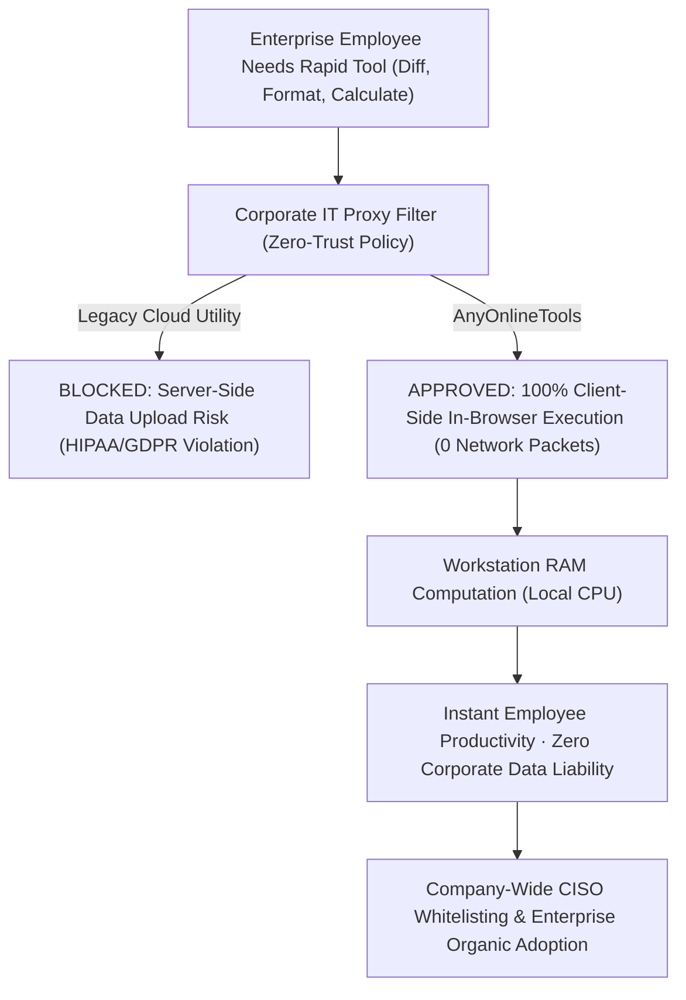

# Enterprise B2B Productivity & Zero-Trust Architecture Blueprint
> **File:** `tool-intel/enterprise-b2b-productivity-and-zero-trust-suite.md`  
> **Platform:** AnyOnlineTools (`https://anyonlinetools.com`)  
> **Category:** B2B Enterprise Solutions, Zero-Trust Whitelisting & Corporate IT Architecture  
> **Status:** Strategic Blueprint #30  

---

## 1. STRATEGIC PURPOSE & THE CORPORATE ZERO-TRUST CRISIS

Enterprise knowledge workers across Fortune 500 corporations, government agencies, healthcare networks, and financial institutions frequently need rapid online utilities:
- Formatting confidential JSON payloads
- Comparing redlined contract drafts
- Generating cryptographically secure passwords
- Calculating financial percentages and profit margins
- Anonymizing proprietary data in internal screenshots

### The Enterprise Dilemma:
Legacy online utility platforms require employees to **upload files and text to remote third-party cloud servers**. This introduces catastrophic security liabilities:
- **Trade Secret Exposure:** Proprietary source code and financial forecasts sitting on commercial servers.
- **Regulatory Penalties:** Severe violations of **HIPAA** (healthcare), **GLBA** (banking), and **GDPR** (privacy).
- **IT Firewall Blocks:** Corporate Chief Information Security Officers (CISOs) routinely block legacy utility sites via Zscaler, Palo Alto Networks, and Cisco Umbrella to prevent data exfiltration.



---

## 2. COMPETITOR DECONSTRUCTION: WHAT WORKS VS. WHAT FAILS

### What the Competitor Does Effectively:
1. **Industry-Specific Sector Categorization:**
   - Segments solutions by business department: *Human Resources, Legal, Finance, Real Estate, Sales, Healthcare.*
2. **Enterprise Authority Metrics:**
   - Uses impressive volume numbers: *30M+ global users, 20K+ businesses, 99.9% uptime guarantee.*
3. **Corporate Feature Positioning:**
   - Highlights batch processing, desktop offline apps, single sign-on (SSO), and developer APIs.
4. **Executive Testimonial Validation:**
   - Features social proof from prominent corporate leaders (e.g., Head of Regional Sales at Saab).

### The Competitor's Fatal Commercial Flaw:
The competitor's model requires **expensive per-seat recurring subscription contracts, vendor risk assessments, SOC 2 compliance audits, and legal DPA signing**. Small teams and enterprise departments must spend weeks navigating internal procurement bureaucracy just to format text or convert documents.

### AnyOnlineTools 10x Zero-Trust Paradigm:
| Parameter | Legacy Competitor Business Plan | AnyOnlineTools Zero-Trust Standard |
| :--- | :--- | :--- |
| **Data Transmission** | Files sent across public internet to cloud servers. | **0 Bytes Transmitted:** 100% Client-Side execution in browser RAM. |
| **IT Procurement Friction** | Requires security audits, DPAs, and weeks of legal review. | **Zero Friction:** Immediate whitelisting; zero data exfiltration risk. |
| **Pricing & Seat Licensing** | Expensive recurring monthly per-user licensing fees. | **100% Free Forever:** Unlimited enterprise seats with zero budget impact. |
| **Air-Gapped Operation** | Fails on disconnected internal defense/financial intranets. | **Full Offline PWA:** Runs on air-gapped workstations with no internet. |
| **Account & Credential Risk** | Centralized database of employee passwords vulnerable to breaches. | **Zero Account Vulnerability:** No accounts, no passwords, zero breach surface. |

---

## 3. SECTOR-BY-SECTOR CLIENT-SIDE WORKFLOWS

AnyOnlineTools provides tailored operational workflows across critical corporate divisions:

### 1. Human Resources (HR) & People Operations
- **Candidate Anonymization:** Use the *Blur Image* and *Blur Text* tools to redact candidate names, photos, and addresses from resumes for unbiased hiring evaluations.
- **Credential Generation:** Use the *Strong Password Generator* to generate high-entropy 24-character temporary passwords for new employee onboarding.
- **Compensation & Equity Math:** Calculate merit raises, bonus splits, and equity percentages using the *Percentage Calculator*.

### 2. Legal Counsel & Contract Administration
- **Contract Revision Auditing:** Use the *Text Diff Checker* to compare two versions of an NDA, master services agreement (MSA), or partnership contract to spot unapproved redline modifications.
- **Clause Indexing & Cleanup:** Clean messy legal indexes and deduplicate signature rosters using *Remove Duplicate Lines*.
- **100% Confidentiality:** Sensitive client privileged information never leaves the attorney's workstation.

### 3. Software Engineering, DevOps & IT Operations
- **API Payload Formatting:** Rapidly inspect, validate, and beautify production API payloads with the *JSON Formatter & Validator*.
- **Data Packet Conversion:** Encode and decode binary payloads, data URLs, and web headers with the *Base64 Converter* and *URL Encoder/Decoder*.
- **Release Verification:** Compute SHA-256 and SHA-512 cryptographic checksums to verify internal code builds and distribution binaries via the *Hash Generator*.
- **Identifier Provisioning:** Generate collision-free UUID v4 identifiers for database records and distributed microservices with the *UUID Generator*.

### 4. Finance, Accounting & Tax Operations
- **Financial Variance Analysis:** Calculate year-over-year revenue variances, gross margin shifts, and discount impacts using the *Percentage Calculator*.
- **Financial Table Cleanup:** Format and convert messy ledger exports using *Case Converter* and whitespace utilities.
- **Zero Financial Data Transmission:** Financial spreadsheets and tax numbers never touch external servers.

### 5. Sales Operations & Digital Marketing
- **Marketing Campaign Routing:** Generate clean SVG and high-res PNG QR codes for trade show booths, product packaging, and sales collaterals with the *QR Code Generator*.
- **Tracking Parameter Sanitization:** Encode complex UTM tracking URLs for marketing attribution with the *URL Encoder/Decoder*.

---

## 4. ZERO-TRUST IT WHITELISTING SPECIFICATION

For Chief Information Officers (CIOs) and Network Administrators:

### Technical Verification Checklist:
- **Network Packet Inspection:** Inspect network tab in Chrome/Edge Developer Tools (`F12 > Network`). Trigger any tool computation; verify that **zero POST/PUT payloads** are initiated to any external endpoint.
- **Execution Sandbox:** All computations run inside the browser's JavaScript V8/SpiderMonkey sandbox without requiring native binary execution privileges.
- **Firewall & Proxy Rules:**
  - Whitelist Hostname: `https://anyonlinetools.com`
  - Required Port: `443` (HTTPS only)
  - WebSocket / WebRTC: None required.
- **PWA Air-Gapped Deployment:** Once loaded, click the "Install App" button in Chrome or Edge to cache the full PWA locally. The workstation can be completely disconnected from the network and utilized indefinitely in offline corporate environments.

---

## 5. E-E-A-T STRUCTURED DATA & SCHEMA MARKUP

```html
<script type="application/ld+json">
{
  "@context": "https://schema.org",
  "@graph": [
    {
      "@type": "WebPage",
      "@id": "https://anyonlinetools.com/business/#webpage",
      "url": "https://anyonlinetools.com/business/",
      "name": "AnyOnlineTools for Enterprise – Zero-Trust Business Productivity Suite",
      "description": "100% client-side online utilities for enterprise HR, legal, finance, and engineering teams. Zero data leakage, zero procurement costs, and instant IT whitelisting.",
      "publisher": {
        "@type": "Organization",
        "name": "AnyOnlineTools",
        "url": "https://anyonlinetools.com/",
        "logo": "https://anyonlinetools.com/icon-512.png"
      }
    }
  ]
}
</script>
```

---

## 6. 26-LANGUAGE MULTI-REGIONAL B2B VOCABULARY

| Language | Enterprise Tagline |
| :--- | :--- |
| **English (`en`)** | "Zero-Trust Enterprise Utility Suite · 100% Client-Side Privacy · Instant IT Whitelisting" |
| **Hindi (`hi`)** | "कॉर्पोरेट और बिज़नेस के लिए ज़ीरो-ट्रस्ट वेब टूल्स · 100% इन-ब्राउज़र गोपनीयता · बिना किसी सर्वर लीकेज के" |
| **Spanish (`es`)** | "Suite de productividad empresarial Zero-Trust · 100% privacidad en el navegador · Cero fugas de datos" |
| **German (`de`)** | "Zero-Trust Unternehmenswerkzeuge · 100% lokale Browser-Privatsphäre · Sofortige IT-Freigabe" |
| **French (`fr`)** | "Outils d'entreprise Zero-Trust · Confidentialité 100% locale dans le navigateur · Zéro fuite de données" |
| **Japanese (`ja`)** | "ゼロトラスト対応の企業向けオンラインツール群 · 100% ブラウザ内ローカル処理 · データ漏洩リスクゼロ" |
| **Chinese (`zh-cn`)** | "零信任企业级实用工具套件 · 100% 浏览器本地计算 · 零数据泄露风险 · 即开即用" |
| **Arabic (`ar`)** | "أدوات متقدمة للشركات بنظام Zero-Trust · خصوصية محلية 100% داخل المتصفح · بدون أي تسريب للبيانات" |

---

## 7. COMPLETE ORIGINAL FAQ SET (ENTERPRISE IT & LEGAL)

### Q1: Why can enterprise IT departments immediately approve AnyOnlineTools without a formal security review?
**A:** Traditional cloud tools require security reviews because they store confidential business data on their servers. AnyOnlineTools operates on a 100% client-side architecture where data never leaves the employee's browser RAM. Because no data is transmitted across the network, there is zero vendor data risk or breach liability for your IT department.

### Q2: Does AnyOnlineTools comply with corporate HIPAA, GDPR, and SOC 2 requirements?
**A:** Yes, by architecture. Under HIPAA and GDPR, data processing regulations apply when protected data is transmitted to or stored by a third party. Because AnyOnlineTools never receives, transmits, or stores user data, your company retains 100% exclusive custody of all proprietary information on localhost.

### Q3: Can AnyOnlineTools be deployed across an entire corporate fleet via MDM or group policy?
**A:** Yes. IT administrators can deploy AnyOnlineTools to thousands of workstations as an installed Progressive Web App (PWA) via Microsoft Intune, Google Workspace Admin, or Active Directory Group Policy without writing custom integration code.

### Q4: Are there per-user licensing fees, seat minimums, or enterprise contracts?
**A:** No. AnyOnlineTools is 100% free forever for all businesses, departments, and organizations. There are no licensing fees, no renewal invoices, and no user seat limits.

### Q5: How can our network security team verify that no data is being exfiltrated?
**A:** Simply open Developer Tools (`F12 > Network tab`) on any modern browser and perform any tool operation (formatting JSON, calculating hashes, diffing text). You will observe zero outgoing POST or WebSocket packets containing your payload.
