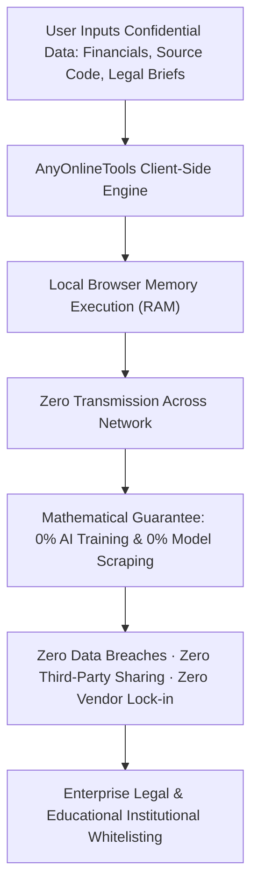

# Zero AI Training & GDPR Data Processor Standard Blueprint
> **File:** `tool-intel/zero-ai-training-and-gdpr-data-processor-standard.md`  
> **Platform:** AnyOnlineTools (`https://anyonlinetools.com`)  
> **Category:** Global Legal Compliance, Ethical AI Safeguards & Enterprise DPA  
> **Status:** Strategic Blueprint #26  

---

## 1. STRATEGIC CONTEXT: THE 2026 AI DATA-HARVESTING CRISIS

In the modern AI era, the number one fear among enterprise executives, writers, programmers, and students when using online tools is:  
**"Is this website secretly feeding my confidential documents, code, or personal writing into an AI training dataset?"**

Dozens of popular "free" conversion sites have quietly altered their terms of service to scrape user-uploaded files to train, fine-tune, and commercialize Large Language Models (LLMs) or vision models.

By publishing an explicit, legally binding **Zero AI Training Guarantee** and a clear **GDPR Data Processor Standard**, AnyOnlineTools establishes supreme market trust and becomes the gold standard for privacy-conscious institutions.



---

## 2. COMPETITOR LEGAL DECONSTRUCTION: WHAT WORKS VS. WHAT FAILS

### What the Competitor Does Effectively:
1. **Prominent AI Training Exclusion:**  
   *"DOES NOT USE YOUR CONTENT TO TRAIN, IMPROVE, OR DEVELOP ITS AI MODELS OR ANY THIRD-PARTY AI MODELS."*  
   This single sentence alleviates massive enterprise anxiety.
2. **Clear Data Protection Roles (GDPR):**  
   Distinguishes between acting as a *Data Controller* (for account/billing info) and a *Data Processor* (for user files).
3. **Student & Educational Minor Safeguards:**  
   Explicit commitments for schools and universities: no targeted advertising, minimal necessary analytics.
4. **Data Protection Officer (DPO) Channel:**  
   Provides a direct point of contact for privacy questions and regulatory rights (access, rectification, erasure).

### The Competitor's Residual Risk:
The competitor admits that files uploaded to their cloud remain on remote servers for **up to TWO (2) HOURS**. During those two hours:
- Files reside on cloud storage providers.
- Sub-processors in various geographic jurisdictions hold access.
- International data transfer mechanisms (Standard Contractual Clauses / SCCs) must be legally maintained.

### AnyOnlineTools 10x Superior Legal Reality:
| Legal Parameter | Legacy Competitor | AnyOnlineTools Client-Side Standard |
| :--- | :--- | :--- |
| **Server Retention Window** | 2 Hours on external cloud servers | **0 Seconds:** Files never leave the user's browser. |
| **Data Processor Liability** | Heavy: Platform processes & stores client data | **Exempt by Architecture:** The platform never takes custody or possession of user files. |
| **AI Training Risk** | Relies on corporate policy promise | **Mathematically Impossible:** We cannot train AI on data our servers never receive. |
| **DPA Requirement for IT** | Mandatory complex legal vendor DPA signing | **Bypassed:** Zero data processing on external servers means zero vendor risk for IT. |
| **Educational & Minor Safety**| Requires special accounts & monitoring | **Inherently Safe:** No accounts, no student data collection, no ad-tech tracking. |

---

## 3. THE ANYONLINETOOLS ZERO AI MODEL TRAINING CHARTER

To be published transparently across `/privacy/`, `/terms/`, and our legal documentation:

> ### 🛡️ The Zero AI Training & Anti-Scraping Commitment
> **AnyOnlineTools does not use, inspect, analyze, retain, or share any user content (including text, source code, passwords, mathematical inputs, images, or documents) to train, fine-tune, evaluate, or improve any first-party or third-party artificial intelligence (AI), machine learning (ML), or large language model (LLM).**
>
> Because all processing occurs 100% locally within your device's web browser via client-side Web Workers, HTML5 Canvas, and Web APIs, our web servers never receive your data payloads. It is technically and mathematically impossible for our platform to scrape or train AI models on your intellectual property.

---

## 4. GDPR DATA PROCESSOR & CONTROLLER FRAMEWORK

### 1. Data Controller Role:
- **Scope:** Applies strictly to voluntary communications when a user contacts us via `hello@anyonlinetools.com` or our Contact Form.
- **Legal Basis:** GDPR Article 6(1)(f) (Legitimate Interest in responding to user inquiries) or Article 6(1)(b) (Performance of contract).
- **Data Minimization:** No personal data is collected during regular tool execution.

### 2. Data Processor Exemption:
- When users utilize AnyOnlineTools to format text, generate QR codes, calculate percentages, or blur images containing confidential or personal data:
- **No Data Processing on Servers:** AnyOnlineTools does not act as a traditional cloud data processor because no data transmission occurs across our network infrastructure. The user retains 100% exclusive custody of their files within their local hardware.

### 3. Student, Minor & Educational Safe Harbor:
- AnyOnlineTools is built to be a safe, ad-free, un-gated utility for schools, universities, and coding bootcamps.
- Compliant with **COPPA** (Children's Online Privacy Protection Act) and **FERPA** guidelines: zero student tracking, zero behavioral advertising, zero user account creation.

---

## 5. TECHNICAL DEFENSE & IMPLEMENTATION

### Zero-Telemetry Client-Side Sandbox:
```typescript
/**
 * Invariant: Client-Side Execution Sandbox
 * Guarantees that tool operations execute strictly within local scope
 * without initiating XMLHttpRequest, Fetch, or WebSocket transmissions.
 */
export function assertClientSideOnly(): void {
  if (typeof window === 'undefined') {
    throw new Error('This utility must execute strictly client-side.');
  }
}
```

### Static Asset Delivery Headers:
To prevent third-party proxy sniffing and enforce zero-telemetry caching:
```apache
<IfModule mod_headers.c>
  # Block third-party content embedding & script injection
  Header set X-Content-Type-Options "nosniff"
  Header set X-Frame-Options "SAMEORIGIN"
  Header set Referrer-Policy "strict-origin-when-cross-origin"
  Header set Permissions-Policy "camera=(), microphone=(), geolocation=(), browsing-topics=()"
</IfModule>
```

---

## 6. 26-LANGUAGE MULTI-REGIONAL AI & PRIVACY DECLARATION

| Language | Official Zero AI Training Declaration |
| :--- | :--- |
| **English (`en`)** | "AnyOnlineTools never uses your content to train, test, or improve AI models. 100% Client-Side Private." |
| **Hindi (`hi`)** | "AnyOnlineTools आपके किसी भी डेटा या कंटेंट का उपयोग AI मॉडल्स को ट्रेन करने के लिए कभी नहीं करता है।" |
| **Spanish (`es`)** | "AnyOnlineTools nunca utiliza su contenido para entrenar o mejorar modelos de inteligencia artificial." |
| **German (`de`)** | "AnyOnlineTools verwendet Ihre Daten niemals zum Trainieren oder Verbessern von KI-Modellen." |
| **French (`fr`)** | "AnyOnlineTools n'utilise jamais vos contenus pour entraîner ou développer des modèles d'intelligence artificielle." |
| **Japanese (`ja`)** | "AnyOnlineToolsはお客様のコンテンツをAIモデルの学習や改善に使用することは一切ありません。" |
| **Chinese (`zh-cn`)** | "AnyOnlineTools 绝不使用您的任何内容来训练、优化或开发 AI 模型。" |
| **Arabic (`ar`)** | "لا تستخدم AnyOnlineTools بياناتك أو محتواك أبداً لتدريب أو تحسين نماذج الذكاء الاصطناعي." |

---

## 7. COMPLETE ORIGINAL FAQ SET (LEGAL & AI PRIVACY)

### Q1: Does AnyOnlineTools use my uploaded files, code, or text to train AI models?
**A:** No, absolutely not. AnyOnlineTools does not use, inspect, analyze, or share any of your text, files, images, or code to train, fine-tune, or develop any artificial intelligence or machine learning models. Because all processing executes locally in your browser, our servers never receive your files in the first place.

### Q2: Why does AnyOnlineTools not require a signed Data Processing Agreement (DPA) from corporate IT?
**A:** Traditional cloud software requires a DPA because their servers store and process your data. AnyOnlineTools operates on a zero-knowledge, client-side architecture where no data is ever transmitted to our infrastructure. Since we never process or store your data on external servers, there is zero vendor data liability for your IT department.

### Q3: Is AnyOnlineTools safe for students and educational institutions?
**A:** Yes. AnyOnlineTools does not require accounts, does not collect personal information from minors, and does not run behavioral tracking algorithms. Teachers, students, and schools can safely use all tools in compliance with COPPA, FERPA, and GDPR requirements.

### Q4: Does AnyOnlineTools transfer user data to third countries or international servers?
**A:** No. Because our tools execute locally within your device's browser memory, your documents and inputs are never transmitted across borders or to foreign cloud hosting providers.

### Q5: Who can I contact regarding legal compliance or data protection questions?
**A:** You can reach our dedicated legal and privacy team at `hello@anyonlinetools.com`. All regulatory, compliance, and enterprise whitelisting inquiries are addressed within 24–48 business hours.
